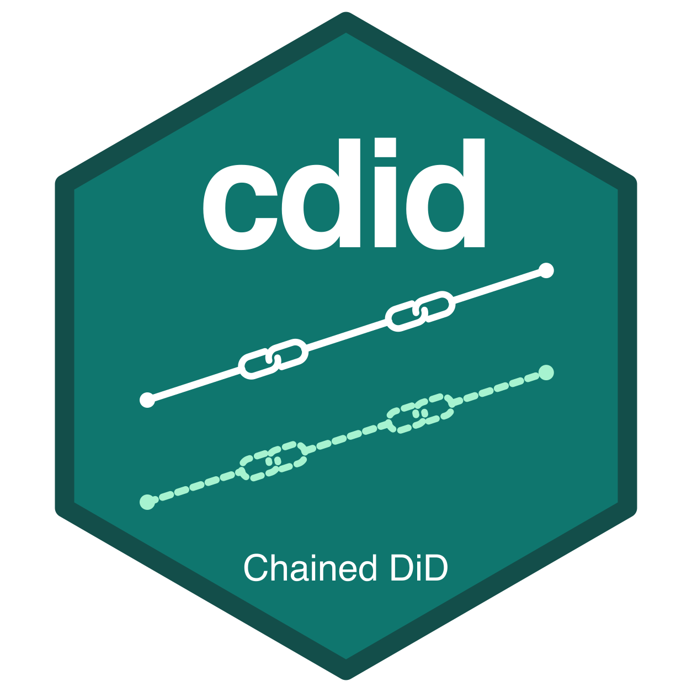

# cdid 

`cdid` brings widely used difference-in-differences estimators into a common framework for complete and incomplete panels. It reproduces documented specifications of established methods and extends them with chained comparisons, observation weighting, change imputation and doubly robust corrections for selective missingness, by leveraging the chained difference-in-differences (chained DiD).

[CRAN package page](https://cran.r-project.org/package=cdid) · [Release notes](https://github.com/dvbn/cdid/blob/main/NEWS.md) · [User guide](https://github.com/dvbn/cdid/blob/main/docs/README.md) · [Author website](https://www.davidbenatia.com/research/)

This guide describes `cdid` **1.3.0.1**. Articles label the version used for recorded output. Check your installed version with `packageVersion("cdid")` and consult the [release notes](https://github.com/dvbn/cdid/blob/main/NEWS.md).

## Installation

Install the current CRAN release in a normal R session:

```r
install.packages("cdid")
library(cdid)
```

Install 1.3.0.1 from GitHub when the CRAN release is older or when you want to follow the `main` branch:

```r
# Run once if remotes is not installed:
install.packages("remotes")
remotes::install_github("dvbn/cdid")
library(cdid)
```

The CRAN package includes a short vignette covering an incomplete panel, estimation, diagnostics, aggregation and plotting. To build it when installing from GitHub, add `build_vignettes = TRUE` and have `knitr`, `rmarkdown` and Pandoc available. Open it with `vignette("cdid", package = "cdid")`.

### Requirements and build tools

`cdid` requires **R 4.1.0 or later** and the CRAN packages **`did` 2.5.1 or later** and **`DRDID` 1.4.0 or later**. It refuses to load with earlier versions of `did` or `DRDID`. If an error reports an outdated dependency, run `install.packages(c("did", "DRDID"))` and restart R. You do not need GitHub versions of `did` or `DRDID`. Modified forks can have different interfaces even when their version numbers exceed the minimum.

Installing from source compiles the package's C code, so the usual tools for building R packages from source must be available:

- **Windows:** [Rtools](https://cran.r-project.org/bin/windows/Rtools/) matching your R version.
- **macOS:** Xcode Command Line Tools, see [R for macOS tools](https://mac.r-project.org/tools/).
- **Linux:** a C/C++ compiler and `make`, including tools needed by dependencies.

Use a standard CRAN installation of R. If a CRAN mirror or platform binary still offers an older release, install the current source from the main CRAN server with `install.packages("cdid", repos = "https://cran.r-project.org", type = "source")`. The optional [pinned validation setup](https://github.com/dvbn/cdid/blob/main/validation/SETUP.md#optional-pinned-validation-setup) installs exact dependency versions for checks of a revision.

An abrupt **"R session aborted"** can come from incompatible local R installations and compiled packages. Check [which R version RStudio uses](https://support.posit.co/hc/en-us/articles/200486138-Changing-R-versions-for-the-RStudio-Desktop-IDE) and reinstall the affected dependencies with that R installation. For help, include `sessionInfo()` and the installation output in an [issue](https://github.com/dvbn/cdid/issues).

## Get started

The example uses the `mpdta` county panel shipped with `did`. Treatment is adopted once and kept, so `first.treat` holds each county's adoption year, with 0 for counties never treated. That column is the cohort variable `gname`.

```r
fit <- cdid::att_gt(
  yname = "lemp", tname = "year", idname = "countyreal",
  gname = "first.treat", xformla = ~lpop, data = did::mpdta,
  bstrap = FALSE, cband = FALSE
)
summary(fit)

event_study <- cdid::aggte(fit, type = "dynamic", bstrap = FALSE, cband = FALSE)
cdid::ggdid(event_study)
```

`summary(fit)` shows the ATT(g,t) table under a heading that names the chained estimator, then a short record: the available cells and the reasons for unavailable ones, the unit table, the handling of missing outcomes, the parallel trends assumption, the GMM weighting and the inference performed. `aggte()` summarizes the stored cells without refitting, here by time since adoption. `cdid::tidy(fit)` and `cdid::glance(fit)` give the same information as data frames. The defaults are those of `did`: doubly robust treatment adjustment, never-treated controls and no anticipation. `bstrap = FALSE` requests analytical standard errors for fast interactive use.

[Get started](https://github.com/dvbn/cdid/blob/main/docs/get-started.md) walks through a simulated panel with recorded output, the four aggregation types, plots, export and a comparison with `did`. The [practical notebook](https://github.com/dvbn/cdid/blob/main/notebooks/README.md) lets you edit and rerun every example. The [user guide](https://github.com/dvbn/cdid/blob/main/docs/README.md) orders the remaining pages as a reading path.

## What the package does

A treatment cohort is the set of units first treated in the same period. For cohort g and period t, ATT(g,t) is the average effect of the treatment in period t on the units of cohort g. [Callaway and Sant'Anna (2021, *Journal of Econometrics*)](https://doi.org/10.1016/j.jeconom.2020.12.001) define these effects for staggered adoption, estimate each one by comparing the cohort with units never treated or not yet treated, and aggregate them into summaries such as event studies. The `did` package implements their estimators, which adjust for covariates by outcome regression (OR), inverse probability weighting (IPW) or a doubly robust (DR) combination of the two.

`cdid` extends this framework to incomplete panels with the chained DiD of [Bellégo, Benatia and Dortet-Bernadet (2025, *Journal of Econometrics*)](https://doi.org/10.1016/j.jeconom.2024.105783). `did` handles an unbalanced panel either by keeping only the units observed at every date or, with `allow_unbalanced_panel = TRUE`, through repeated cross section (RCS) estimators that compare outcome levels. Chained DiD uses the changes of each unit between the dates at which it is observed and combines all available short comparisons into the effects by the generalized method of moments (GMM). The targets remain the ATT(g,t) of the cohorts of the original study population, including their units with missing outcomes, and the assumptions concern the missing changes rather than the missing levels.

### Why changes within units

Write the outcome of unit i at date t as $Y_{it} = \alpha_i + u_{it}$, where $\alpha_i$ is a fixed individual effect and $u_{it}$ holds everything that varies over time: trends, the treatment effect and noise. The change between two observed dates, $Y_{it} - Y_{is} = u_{it} - u_{is}$, contains no $\alpha_i$. Suppose treated units with persistently low outcomes are more likely to leave the panel while controls leave at random. The treated units still observed later have a higher mean $\alpha_i$, so comparing their outcome levels with earlier ones adds this change in composition to the treatment effect. If attrition depends only on $\alpha_i$ and $\alpha_i$ is unrelated to $u_{it} - u_{is}$, the treated units that remain still have the mean change of their cohort.

This is the main advantage of chained DiD for incomplete panels: observation may depend on the unobservable individual effect, as long as that effect is unrelated to the changes, and the observed levels need not stay representative of the population. Removing the fixed effect does not by itself make missing changes ignorable. If the persistent component is related to trends or to heterogeneous treatment effects, observation that depends on it also selects the changes.

### The assumptions

Within a cohort, the units observed at both dates of a comparison must be representative of that cohort with respect to the mean outcome change over that pair, directly or conditional on covariates with an appropriate adjustment. This equates population expectations of changes. It does not require every unit to have the same change or realized sample means to agree. Parallel trends, no anticipation and overlap must also hold. [Handling missing outcomes](https://github.com/dvbn/cdid/blob/main/docs/methods/missing-outcomes.md#the-assumption-about-missing-outcomes), [Parallel trends](https://github.com/dvbn/cdid/blob/main/docs/methods/parallel-trends.md) and [Treatment adjustment](https://github.com/dvbn/cdid/blob/main/docs/methods/treatment.md) state these assumptions.

Neither approach is better in every design. When the sample at each date represents the population, comparisons of levels can be valid too. [Identify effects when the observed units change composition](https://github.com/dvbn/cdid/blob/main/docs/examples/identification.md) works through a design in which changes identify the effects and levels do not. Differencing removes the persistent unit component, while the transitory noise of each short change accumulates along a chain, so which approach is more precise depends on the design, as Bellégo, Benatia and Dortet-Bernadet (2025, Section 2.1.3 and Proposition 1) analyze. [How to compare precision](https://github.com/dvbn/cdid/blob/main/docs/examples/precision.md) explains how to compare them on matched targets.

### Two modes

`cdid` imports `did` and keeps its function names and argument order: `att_gt()`, `aggte()`, `ggdid()`, `tidy()`, `glance()` and `conditional_did_pretest()`. Most upstream defaults are retained, including treatment DR in `att_gt()`.

- **Chained mode** is the default for panel data. It estimates the usable short comparisons between pairs of dates at which units are observed and combines them by GMM. An effect that these comparisons cannot recover, given cohort and control support and the assumptions, is reported as [unavailable with a reason](https://github.com/dvbn/cdid/blob/main/docs/help/troubleshooting.md#an-effect-is-unavailable), never as zero.
- **Ordinary mode**, requested with `mode = "ordinary"` and used automatically for repeated cross sections, passes the call unchanged to `did`. `allow_unbalanced_panel = NULL` resolves according to the mode. [Moving from did](https://github.com/dvbn/cdid/blob/main/docs/from-did.md) explains the differences and the added arguments.

## Data and model decisions

The decisions below come in the order you meet them. Each links to the guide page that states the assumption behind the choice.

### 1. Prepare the panel and the unit table

Supply a long data frame with one row per unit and date: a unit identifier, a finite numeric date, a numeric outcome with missing values kept as `NA`, and the treatment column. Never replace a missing outcome with zero or a carried-forward value. The units in `data` form the study population. To include study units with no observed outcome, pass a unit table with one row per unit through `frame`. Units observed once or never supply no change but stay in the cohort shares, the observation models and the standard errors.

Covariates that change over time are read at each cohort's reference date from the dated rows in `data`. A unit can contribute its change from years 3 to 4 even if its year-2 outcome is missing. If the comparison uses a covariate from year 2 and you know its value, supply it on the year-2 row with `y = NA`. If the covariate is unknown, `att_gt()` warns and excludes the unit from that cohort's comparisons under the default `missing_reference = "exclude"`. The unit can still contribute to other cohorts for which its required covariates are known. If treated units are excluded, the effect describes the remaining treated units. Set `missing_reference = "error"` to stop and list the missing inputs. Sampling weights that change within a unit need an explicit `fix_weights` rule.

[Prepare your panel and unit table](https://github.com/dvbn/cdid/blob/main/docs/help/prepare-data.md) · [Add a known reference covariate row](https://github.com/dvbn/cdid/blob/main/docs/help/prepare-data.md#add-a-known-reference-covariate-row) · [Investigate missingness and data structure](https://github.com/dvbn/cdid/blob/main/docs/help/investigate-missingness.md)

### 2. Choose the comparison group and the parallel trends assumption

`control_group` selects never-treated or not-yet-treated controls, as in `did`. `pt_assumption = "post"`, the default, assumes parallel trends from each cohort's reference period onward. `"all"` adds the same assumption from a chosen common start date `pt_start` up to each reference period, so that earlier dates can also serve as baselines. `"ctrl"` keeps PT-post and adds common untreated trends among the clean control cohorts only. Valid added restrictions can make more effects available or improve precision, but neither gain is guaranteed, and false restrictions bias the estimates. `base_period` changes only how cells before treatment are reported, not the assumption.

When a cohort and its eligible controls are observed over different windows and share no date pair, set `cross_pair = TRUE` to link their separate within-unit changes through calendar dates where the trend assumption applies. `chain_report(fit)` shows which comparisons identify each effect and the weights that combine them. The default `gmm_weighting = "optimal"` estimates the moment covariance from the data. `"within"` weights comparisons by their within-unit covariance under uncorrelated level shocks.

[Parallel trends](https://github.com/dvbn/cdid/blob/main/docs/methods/parallel-trends.md) · [Add PT-all restrictions](https://github.com/dvbn/cdid/blob/main/docs/examples/pt-all-comparison.md) · [Cross-pair chaining, PT-ctrl and within-unit weighting](https://github.com/dvbn/cdid/blob/main/docs/methods/cross-pair-chaining.md) · [Short pre-treatment windows](https://github.com/dvbn/cdid/blob/main/docs/examples/short-pretreatment-windows.md) · [GMM weighting and covariance regularization](https://github.com/dvbn/cdid/blob/main/docs/methods/gmm.md)

### 3. Adjust for treatment

`est_method` makes each cohort comparable with its controls by IPW (`"ipw"`), OR (`"reg"`) or DR (`"dr"`, the default), as in `did`. In chained mode, OR and DR regress the controls' outcome changes on covariates. With the default `outcome_pooling = "separate"`, each distinct comparison has its own coefficients. `"pooled"` shares slopes per calendar step across comparisons with local intercepts, the specification of versions before 1.2.0.0. Custom `did`-style IPW functions are accepted on the cohort route.

[Treatment adjustment](https://github.com/dvbn/cdid/blob/main/docs/methods/treatment.md) · [Choose IPW, OR or DR in an incomplete panel](https://github.com/dvbn/cdid/blob/main/docs/examples/treatment-choice.md)

### 4. Adjust for missing outcomes, separately

`selection` states the assumption about missing outcomes. The default `"none"` fits no observation model and requires the observed units of each pair to be representative of their cohort's mean change. `"conditional_mtar"` allows observation to depend on covariates and adjusts for it. `selection_est_method` then chooses observation weighting (`"ipw"`), which weights each observed change by the inverse of its fitted probability of being observed at both dates, change imputation (`"imputation"`), which predicts the actual changes with regressions fitted to the observed changes, or the augmented correction (`"dr"`), which combines the two. All three work with treatment IPW, OR and DR, and `selection_xformla` can give the observation model its own covariates.

Treatment DR with the augmented correction is doubly robust in both layers: for the treatment, either the propensity model or the outcome regression may be misspecified, and for the missing outcomes, either the observation model or the imputation model, provided the other model of each layer and the remaining assumptions are correct. Augmenting the missing-outcome layer does not give treatment IPW or OR the treatment-DR guarantee.

[Handling missing outcomes](https://github.com/dvbn/cdid/blob/main/docs/methods/missing-outcomes.md) · [Which models must be correct](https://github.com/dvbn/cdid/blob/main/docs/methods/missing-outcomes.md#which-models-must-be-correct) · [Choose an observation model](https://github.com/dvbn/cdid/blob/main/docs/examples/observation-models.md) · [Impute actual changes](https://github.com/dvbn/cdid/blob/main/docs/examples/change-imputation.md) · [Sampling information for the observation model](https://github.com/dvbn/cdid/blob/main/docs/methods/sampling-information.md) · [Robustness](https://github.com/dvbn/cdid/blob/main/docs/examples/robustness.md)

### 5. Choose the treatment design

The examples above use an absorbing treatment: units adopt once and stay treated, and effects may evolve with time since adoption. Choose the switching model for entry and exit effects, or the linear fixed-effects specification for an adoption panel.

| Design | What to supply | What you estimate | Aggregate |
| --- | --- | --- | --- |
| Adoption cohorts (default) | `gname`, the first treatment date, with 0 for units never treated | ATT(g,t) for each cohort and date, so effects can evolve with time since adoption | `aggte()`, including event studies |
| Binary treatment that can stop and restart | `dname`, the treatment status at every study date, including dates with missing outcomes | The immediate effect at each entry or exit, under a static model with no carryover of past treatment | `fit$aggregate`, a switcher-weighted average |
| Linear cohort-by-date fixed effects | `gname` and `control = list(preset = "cohort_time_fe")` | Cohort-by-date effects in a linear specification with unit fixed effects and a common untreated calendar path | `aggte()` |

The `dname` model assumes that past treatment has no carryover beyond current status. Identification also depends on parallel trends and support for each entry or exit comparison. Entrants are compared with units that stay untreated and exiters with units that stay treated, and both estimates are reported on the same treated-minus-untreated scale. Treatment and missing-outcome adjustments are chosen as above. Supplying both `gname` and `dname` is an error, and absorbing data supplied through `dname` still requests the static model. The cohort-by-date preset is a linear specification whose regression fit matches R `etwfe` and Stata `jwdid` on the same inputs, with chained handling of gaps and the same treatment and missing-outcome adjustments.

[When treatment can stop and restart](https://github.com/dvbn/cdid/blob/main/docs/methods/static-entry-exit.md) · [Cohort-by-date fixed effects](https://github.com/dvbn/cdid/blob/main/docs/methods/cohort-time-fe.md) · [Options reference](https://github.com/dvbn/cdid/blob/main/docs/reference/options.md)

## Diagnostics and inference

- **Availability.** `tidy(fit)` returns one row per requested cell with `available`, `support.status` and `support.reason`. Unavailable cells are `NA` with a reason. An aggregate that needs an unavailable cell is `NA` unless `na.rm = TRUE` requests the restricted target. See [Diagnose errors and unavailable results](https://github.com/dvbn/cdid/blob/main/docs/help/troubleshooting.md).
- **Identification paths.** `chain_report(fit)` lists the comparisons behind each effect and the weights used to combine them. See [Cross-pair chaining](https://github.com/dvbn/cdid/blob/main/docs/methods/cross-pair-chaining.md).
- **Fitted models.** Set `control = list(keep_nuisance = TRUE)` in `att_gt()`, then call `nuisance_models(fit)` to see the fitted equations, coefficient tables and standard errors of the treatment, outcome, observation and imputation models.
- **Pretrend tests.** The fit records a joint Wald test of the cells before treatment when its covariance allows it. `conditional_did_pretest()` runs the conditional test. Failure to reject does not establish parallel trends. See [Pretrend tests](https://github.com/dvbn/cdid/blob/main/docs/reference/results.md#pretrend-tests).
- **Uncertainty.** `bstrap`, `cband`, `biters` and `alp` follow `did`: multiplier bootstrap standard errors and simultaneous bands by default, analytical standard errors with `bstrap = FALSE`. `clustervars` accepts one cluster variable beyond the unit. Standard errors use complete unit-level influence functions that include the fitted models. `compute_inffunc = FALSE` returns point estimates only. See [Inference](https://github.com/dvbn/cdid/blob/main/docs/examples/inference.md), [Results](https://github.com/dvbn/cdid/blob/main/docs/reference/results.md) and [Uncertainty](https://github.com/dvbn/cdid/blob/main/docs/reference/results.md#uncertainty).

## User guide

The [guide home](https://github.com/dvbn/cdid/blob/main/docs/README.md) orders these pages as a reading path with stages.

| Topic | Pages |
| --- | --- |
| Start with your panel | [Get started](https://github.com/dvbn/cdid/blob/main/docs/get-started.md), [prepare your data](https://github.com/dvbn/cdid/blob/main/docs/help/prepare-data.md), [inspect missingness](https://github.com/dvbn/cdid/blob/main/docs/help/investigate-missingness.md), [hands-on notebook](https://github.com/dvbn/cdid/blob/main/notebooks/README.md) |
| Work with gaps | [Incomplete panels](https://github.com/dvbn/cdid/blob/main/docs/examples/incomplete-panels.md), [changing sample composition](https://github.com/dvbn/cdid/blob/main/docs/examples/identification.md), [short pre-treatment windows](https://github.com/dvbn/cdid/blob/main/docs/examples/short-pretreatment-windows.md) |
| Choose comparisons | [Treatment adjustment](https://github.com/dvbn/cdid/blob/main/docs/methods/treatment.md), [compare IPW, OR and DR](https://github.com/dvbn/cdid/blob/main/docs/examples/treatment-choice.md), [parallel trends](https://github.com/dvbn/cdid/blob/main/docs/methods/parallel-trends.md), [PT-all example](https://github.com/dvbn/cdid/blob/main/docs/examples/pt-all-comparison.md), [cross-pair chaining](https://github.com/dvbn/cdid/blob/main/docs/methods/cross-pair-chaining.md) |
| Adjust for missing outcomes | [Overview](https://github.com/dvbn/cdid/blob/main/docs/methods/missing-outcomes.md), [observation models](https://github.com/dvbn/cdid/blob/main/docs/examples/observation-models.md), [change imputation](https://github.com/dvbn/cdid/blob/main/docs/examples/change-imputation.md), [sampling information](https://github.com/dvbn/cdid/blob/main/docs/methods/sampling-information.md), [robustness](https://github.com/dvbn/cdid/blob/main/docs/examples/robustness.md) |
| Choose the treatment design | [When treatment can stop and restart](https://github.com/dvbn/cdid/blob/main/docs/methods/static-entry-exit.md), [cohort-by-date fixed effects](https://github.com/dvbn/cdid/blob/main/docs/methods/cohort-time-fe.md) |
| Read results | [Options](https://github.com/dvbn/cdid/blob/main/docs/reference/options.md), [results](https://github.com/dvbn/cdid/blob/main/docs/reference/results.md), [GMM weighting](https://github.com/dvbn/cdid/blob/main/docs/methods/gmm.md), [inference](https://github.com/dvbn/cdid/blob/main/docs/examples/inference.md), [compare precision](https://github.com/dvbn/cdid/blob/main/docs/examples/precision.md), [troubleshooting](https://github.com/dvbn/cdid/blob/main/docs/help/troubleshooting.md) |
| Compare software | [Familiar DiD models for incomplete panels](https://github.com/dvbn/cdid/blob/main/docs/comparisons.md), [reproduce R and Stata models](https://github.com/dvbn/cdid/blob/main/docs/from-other-packages.md), [moving from did](https://github.com/dvbn/cdid/blob/main/docs/from-did.md) |

## References

- Bellégo, C., Benatia, D. and Dortet-Bernadet, V. (2025). The Chained Difference-in-Differences. *Journal of Econometrics*, 248, article 105783. <https://doi.org/10.1016/j.jeconom.2024.105783>. arXiv version: <https://arxiv.org/abs/2301.01085>
- Callaway, B. and Sant'Anna, P. H. C. (2021). Difference-in-Differences with Multiple Time Periods. *Journal of Econometrics*, 225(2), pages 200 to 230. <https://doi.org/10.1016/j.jeconom.2020.12.001>
- de Chaisemartin, C., D'Haultfoeuille, X., Pasquier, F., Sow, D. and Vazquez-Bare, G. (2026). Difference-in-Differences Estimators for Treatments Continuously Distributed at Every Period. Working paper, arXiv:2201.06898v7. <https://arxiv.org/abs/2201.06898v7>

Chained IPW (`est_method = "ipw"`) and observation weighting for missing outcomes follow Bellégo, Benatia and Dortet-Bernadet (2025). The package extends these methods with chained OR and DR, change imputation, the augmented correction, PT-all and PT-ctrl, cross-pair chaining, within-unit GMM weighting and the linear cohort-by-date preset. The static `dname` model adapts the static binary specialization of de Chaisemartin, D'Haultfoeuille, Pasquier, Sow and Vazquez-Bare to complete and incomplete panels. The methods pages of the guide state the assumptions each extension needs.

## Roadmap

Further efficiency improvements are planned. Python and Stata versions are planned as well, with separate repositories and documentation.

## Questions and bug reports

Use [GitHub Issues](https://github.com/dvbn/cdid/issues) to ask about using the package or choosing a method and to report reproducible bugs. Include your package version, `sessionInfo()` and a short reproducible example.

## Contributing

See [Contributing](https://github.com/dvbn/cdid/blob/main/CONTRIBUTING.md) to propose a change or help with a reported issue.

## Support the project

If cdid is useful to your work, you can [buy me a coffee](https://buymeacoffee.com/dvbn).
