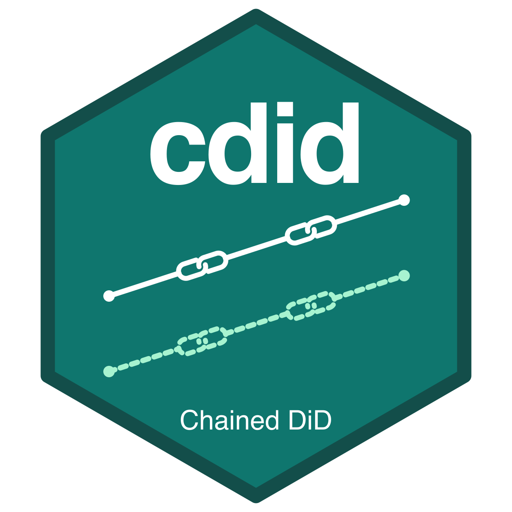

# cdid for R 

`cdid` estimates group time average treatment effects ATT(g,t) with chained difference in differences (chained DiD). It builds upon the [`did` package](https://bcallaway11.github.io/did/) and extends it to panels in which some outcomes may be missing, by using the outcome changes between the dates at which each unit is observed.

[CRAN package page](https://cran.r-project.org/package=cdid)

The current CRAN release is 0.1.1. This repository contains version 1.1.0.0,
which is being prepared for the next CRAN update.

## Installation

```r
# install.packages("remotes")
remotes::install_github("dvbn/cdid")
```

A short hands-on vignette covers an incomplete panel, estimation, diagnostics,
aggregation and plotting. To include it when installing from GitHub, use
`remotes::install_github("dvbn/cdid", build_vignettes = TRUE)` with `knitr`,
`rmarkdown` and Pandoc available. Open it with
`vignette("cdid", package = "cdid")`. The [full user guide](docs/README.md)
and [practical notebook](notebooks/cdid_practical_guide.qmd) provide more examples.

`cdid` 1.1.0.0 requires R 4.1.0 or later, `did` 2.5.1 or later and `DRDID` 1.3.0 or later, and refuses to load with earlier versions of `did` or `DRDID`. If older versions are installed, update them first, for example with `install.packages(c("did", "DRDID"))`. It has been tested with `did` 2.5.1 and `DRDID` 1.3.0 under R 4.5.2. Later versions are accepted but have not been tested, so it is not guaranteed that everything works with them or that results are identical. Installation compiles the package's C/C++ code and therefore needs a compiler toolchain: Rtools on Windows, the command-line developer tools on macOS, or a C/C++ compiler and `make` on Linux. The optional [pinned validation setup](validation/SETUP.md#optional-pinned-validation-setup) installs exactly the tested versions, for example to reproduce the recorded results of this guide.

## What the package does

A treatment cohort is the set of units first treated in the same period. For cohort g and period t, ATT(g,t) is the average effect of the treatment in period t on the units of cohort g. [Callaway and Sant'Anna (2021, *Journal of Econometrics*)](https://doi.org/10.1016/j.jeconom.2020.12.001) define these effects for staggered adoption, estimate each one by comparing the cohort with units never treated or not yet treated, and aggregate them into summaries such as event studies. The `did` package implements their estimators, which adjust for covariates by outcome regression (OR), inverse probability weighting (IPW) or a doubly robust (DR) combination of the two.

`cdid` extends this framework to incomplete panels with the chained DiD of ([Bellégo, Benatia and Dortet-Bernadet (2025, *Journal of Econometrics*)](https://doi.org/10.1016/j.jeconom.2024.105783), [arXiv](https://arxiv.org/abs/2301.01085)). `did` handles an unbalanced panel either by keeping only the units observed at every date or, with `allow_unbalanced_panel = TRUE`, through repeated cross section (RCS) estimators that compare outcome levels. Chained DiD instead uses the changes of each unit between the dates at which it is observed, and combines all available short DiD comparisons into the effects. The targets remain the ATT(g,t) of the cohorts of the original study population, including their units with missing outcomes, and the assumptions concern the missing changes rather than the missing levels, as explained below.

Two adjustments are chosen separately. The treatment adjustment, chosen with `est_method`, makes each cohort comparable with its controls by IPW, OR or DR, as in `did` ([Treatment adjustment](docs/methods/treatment.md)). The adjustment for missing outcomes applies when attrition or other missingness depends on measured covariates related to the changes. With `selection = "conditional_mtar"`, `selection_est_method` chooses observation weighting, which weights each observed change by the inverse of its estimated probability of being observed at both dates (`"ipw"`), change imputation, which predicts the changes with a regression fitted to the observed changes (`"imputation"`), or the augmented correction, which combines the two and requires treatment DR (`"dr"`) ([Handling missing outcomes](docs/methods/missing-outcomes.md#how-to-adjust)). Treatment DR with the augmented correction is doubly robust in both layers: for the treatment, either the propensity model or the outcome regression may be misspecified, and for the missing outcomes, either the observation model or the imputation model, provided the other model of the layer and the remaining assumptions are correct ([Which models must be correct](docs/methods/missing-outcomes.md#which-models-must-be-correct)).

`cdid` also lets you choose between two parallel trends assumptions. PT-post, the default, assumes parallel trends from each cohort's reference period onward. PT-all, which `did` 2.5.1 (the tested version) does not offer, adds the same assumption from a chosen common start date up to each reference period, so that each of those earlier dates can also serve as a baseline. As in Bellégo, Benatia and Dortet-Bernadet (2025), short comparisons between observed dates are combined by the generalized method of moments (GMM), and the system is overidentified when several comparisons inform the same effect. Under PT-post this system already combines the comparisons that PT-post makes valid; PT-all adds to the same system the earlier restrictions that only its stronger assumption justifies. Valid restrictions can make more effects available or improve precision, but neither gain is guaranteed, and false restrictions can bias the estimates ([Parallel trends](docs/methods/parallel-trends.md#pt-all)). How cells before treatment are reported is a separate choice, `base_period`, which changes neither assumption. A future release will incorporate additional efficiency options.

`cdid` imports `did` and keeps familiar function names and upstream argument order: `att_gt()`, `aggte()`, `ggdid()`, `tidy()`, `glance()` and `conditional_did_pretest()`. Most upstream defaults are retained, including treatment DR for `att_gt()`. Panel data select chained mode by default, and `allow_unbalanced_panel = NULL` resolves according to the mode. The [migration page](docs/from-did.md) explains these differences and the added chained arguments.

- **Chained mode** is the default for panel data. It estimates the usable short comparisons between pairs of dates at which units are observed and combines them by GMM into the effects. A unit contributes the changes between its observed dates, so the panel does not need to be complete. An effect that these comparisons cannot recover, given cohort and control support and the assumptions, is reported as [unavailable with a reason](docs/help/troubleshooting.md#an-effect-is-unavailable).
- **Ordinary mode**, requested with `mode = "ordinary"` and used automatically for repeated cross sections, passes the call unchanged to `did`.

Let us illustrate how Chained DiD works with changes within the same unit. Write the outcome of unit i at date t as $Y_{it} = \alpha_i + u_{it}$, where $\alpha_i$ is a fixed individual effect and $u_{it}$ holds everything that varies over time: trends, the treatment effect and noise. The change between two observed dates, $Y_{it} - Y_{is} = u_{it} - u_{is}$, contains no $\alpha_i$. Suppose that treated units with low $\alpha_i$, that is with persistently low outcomes, are more likely to leave the panel, while controls leave at random. The treated units still observed at later dates then have a higher mean $\alpha_i$, so comparing their outcome levels with earlier ones adds this change in composition to the treatment effect. Thus, if attrition depends only on $\alpha_i$ and $\alpha_i$ is unrelated to $u_{it} - u_{is}$, the treated units that remain still have the mean change of their cohort.

This is the main advantage of chained DiD for incomplete panels: whether an outcome is observed may depend on the unobservable individual effect, as long as that effect is unrelated to the changes, and the observed levels need not remain representative of the population. For RCS comparisons, changing composition must not distort the relevant conditional level comparisons. Representative samples at each date are one sufficient condition. Assuming missing completely at random (MCAR) guarantees this, but is stronger than necessary. Attrition related to persistent differences between units can violate that condition.

Chained DiD has its own assumptions. Within a cohort, the units observed in a given pair must be representative of that cohort with respect to the mean outcome change over that pair, possibly conditional on covariates with an appropriate adjustment. This equates population expectations of changes. It does not require every unit to have the same change, exact equality of realized sample means, or equality of the full distributions. Parallel trends, no anticipation and overlap must also hold. [Handling missing outcomes](docs/methods/missing-outcomes.md#the-assumption-about-missing-outcomes), [Parallel trends](docs/methods/parallel-trends.md) and [Treatment adjustment](docs/methods/treatment.md) state these assumptions. Neither approach is always better in every design: when the sample at each date represents the population, comparisons of levels can be valid too. [Identify effects when the observed units change composition](docs/examples/identification.md) works through a design in which the changes identify the effects and comparisons of levels do not.

In practice, unless you can rule out that attrition or other missingness is related to persistent unobserved differences between units, chained DiD is the safer choice, provided its assumptions about changes hold. When observation plausibly depends on such stable differences in outcomes, comparisons of observed levels mix the change in composition with the effects, whereas the changes do not contain the persistent component. Removing the fixed effect does not by itself make the missing changes ignorable, however: if the persistent component is related to trends or to heterogeneous treatment effects, observation that depends on it also selects the changes, and the assumption about changes can fail.

Chained DiD can also be more precise than RCS comparisons when both are valid. Differencing removes the persistent unit component $\alpha_i$, whose variation otherwise adds noise to comparisons of levels, while the transitory noise of each short change accumulates along a chain. Bellégo, Benatia and Dortet-Bernadet (2025, Section 2.1.3 and Proposition 1) analyze this trade-off under their outcome model with outcomes missing completely at random: the gain in precision depends on how persistent the outcomes are, how much units differ and how far apart the compared dates are, so neither approach is more precise in every design. [How to compare precision](docs/examples/precision.md) explains how to compare them on matched targets.

## References

- Bellégo, C., Benatia, D. and Dortet-Bernadet, V. (2025). The Chained Difference-in-Differences. *Journal of Econometrics*, 248, article 105783. <https://doi.org/10.1016/j.jeconom.2024.105783>. arXiv version: <https://arxiv.org/abs/2301.01085>

- Callaway, B. and Sant'Anna, P. H. C. (2021). Difference-in-Differences with Multiple Time Periods. *Journal of Econometrics*, 225(2), pages 200 to 230. <https://doi.org/10.1016/j.jeconom.2020.12.001>

Chained IPW (`est_method = "ipw"`) and observation weighting for missing outcomes follow Bellégo, Benatia and Dortet-Bernadet. The package extends these papers with chained OR and DR, which carry the OR and DR approaches over to chained comparisons through one pooled regression of the controls' outcome changes, and with change imputation and PT-all. The [augmented correction](docs/methods/missing-outcomes.md#augmented-correction) for missing outcomes, which combines an observation model with a change imputation model and is used with treatment DR, is a further extension; an accompanying paper is about to be released. The methods pages in the reading path state the assumptions each extension needs.

## Reading path

Each page of the guide ends with links to the previous and next steps and a collapsible list of all steps.

For the input requirements and a practical check of your observation patterns, start with [Prepare your panel and unit table](docs/help/prepare-data.md) and [Investigate missingness and data structure](docs/help/investigate-missingness.md). The latter shows counts across study units, selected-pair support and the diagnostics available from a fitted result. Observed missingness patterns alone cannot establish the required representativeness of mean changes.

For hands-on exploration, use the [editable Quarto source](notebooks/cdid_practical_guide.qmd) or [download the standalone HTML with results](https://github.com/dvbn/cdid/raw/refs/heads/main/notebooks/cdid_practical_guide.html). Download the HTML file and open it in a browser to read the tables and plots without running R. One editable configuration controls the synthetic panel, and the sections walk through estimation, missingness, selection models, aggregation, inference and diagnostics. The [notebook instructions](notebooks/README.md) explain how to run the code or open its rendered HTML with tables and plots.

| Step | Page | Description |
| --- | --- | --- |
| 1 | [Get started](docs/get-started.md) | Main functions on a balanced panel: estimation, summaries, aggregation, plots and export. |
| 2 | [Moving from did](docs/from-did.md) | What stays familiar, how incomplete panels are treated, and [why balanced results can differ and which to use](docs/from-did.md#why-can-balanced-results-differ-and-which-should-i-use). |
| 3 | [Incomplete panels](docs/examples/incomplete-panels.md) | Which changes an observation pattern supplies and how chaining combines them, with a rotating panel example. |
| 4 | [Identify effects when the observed units change composition](docs/examples/identification.md) | When changes within units identify effects that comparisons of observed levels do not. |
| 5 | [How to compare precision](docs/examples/precision.md) | Matched targets and assumptions, covariance, and what standard errors can show. |
| 6 | [Prepare your panel and unit table](docs/help/prepare-data.md) | Identifiers, missing outcomes kept as `NA`, the unit table, and changing covariates or weights. |
| 7 | [Treatment adjustment](docs/methods/treatment.md) | How IPW, OR and DR make a cohort comparable with its controls. |
| 8 | [Choose IPW, OR or DR in an incomplete panel](docs/examples/treatment-choice.md) | The three treatment adjustments compared on one incomplete panel. |
| 9 | [Handling missing outcomes](docs/methods/missing-outcomes.md) | The study population, the assumption about missing outcomes and the three ways to adjust for them. |
| 10 | [Sampling information for the observation model](docs/methods/sampling-information.md) | Advanced: fitting the observation model on part of the unit table. |
| 11 | [Choose an observation model](docs/examples/observation-models.md) | Date or pair logits, and how many slopes they share. |
| 12 | [Impute actual changes](docs/examples/change-imputation.md) | Observation weighting, change imputation and the augmented correction compared on one panel. |
| 13 | [Parallel trends](docs/methods/parallel-trends.md) | PT-post, PT-all and the separate reporting choice `base_period`. |
| 14 | [Add PT-all restrictions](docs/examples/pt-all-comparison.md) | What true and false PT-all restrictions change on one incomplete panel. |
| 15 | [GMM weighting and covariance regularization](docs/methods/gmm.md) | How comparisons are combined and what covariance regularization does. |
| 16 | [Robustness](docs/examples/robustness.md) | Which models must be correct for each combination of treatment adjustment and missing outcome handling. |
| 17 | [Inference](docs/examples/inference.md) | Intervals, bands, clustering, aggregation and pretrend tests. |
| 18 | [Options](docs/reference/options.md) | Every argument with its default, accepted values and when it is active. |
| 19 | [Results](docs/reference/results.md) | The contents of each result, the uncertainty rules, pretrend tests and export. |
| 20 | [Diagnose errors and unavailable results](docs/help/troubleshooting.md) | Refused requests, failed fits, unavailable effects and surprising results. |

This guide describes version 1.1.0.0. Numerical code output shown on the article pages comes from recorded runs, and each page states the version actually used. Analytical population values are labeled separately.

## Terms used in this guide

| Term | Meaning |
| --- | --- |
| Study population | The population whose treatment effects the analysis describes. |
| Unit table | One row per study unit, supplied through the `frame` argument, including units with one or no observed outcomes. Without `frame`, the units present in `data` form it. |
| Treatment cohort | Units first treated in the same period. `gname` holds that period, and 0 marks units never treated. |
| Units observed at both dates | The units whose outcomes are observed at both dates of a comparison. Only they contribute that change. |
| Treatment adjustment | How each cohort is made comparable with its controls: IPW, OR or DR, chosen with `est_method`. |
| Handling missing outcomes | The assumption made about missing outcomes and the way the package adjusts for them, chosen with the arguments that begin with `selection` and with `imputation_pooling`. |
| PT-post and PT-all | Parallel trends from each cohort's reference period onward, and the same assumption with additional restrictions from a common start date. |

## Roadmap

More efficient estimators will be implemented in later releases.

Python and Stata versions are planned. They will have separate repositories and documentation.

## Questions and bug reports

Use [Discussions](https://github.com/dvbn/cdid/discussions) for questions about using the package or choosing a method. Use [Issues](https://github.com/dvbn/cdid/issues) for reproducible bugs. Include the package version and reproducible example.

See [Contributing](https://github.com/dvbn/cdid/blob/main/CONTRIBUTING.md) to suggest a change.

## Contributing

Have spare Codex subscription capacity and want to support cdid? Use your own account to complete a [scoped contributor task](contributing/TASKS.md), then return your code, checks or findings for review. We provide [public instructions](AGENTS.md) and a [reusable skill](.agents/skills/cdid-contribution/SKILL.md). You choose your time and usage budget and keep your credentials private. Contributions without coding agents are equally welcome. See [Contributing](CONTRIBUTING.md) to get started.

## Support the project

If cdid is useful to your work, you can [buy me a coffee](https://buymeacoffee.com/dvbn).
