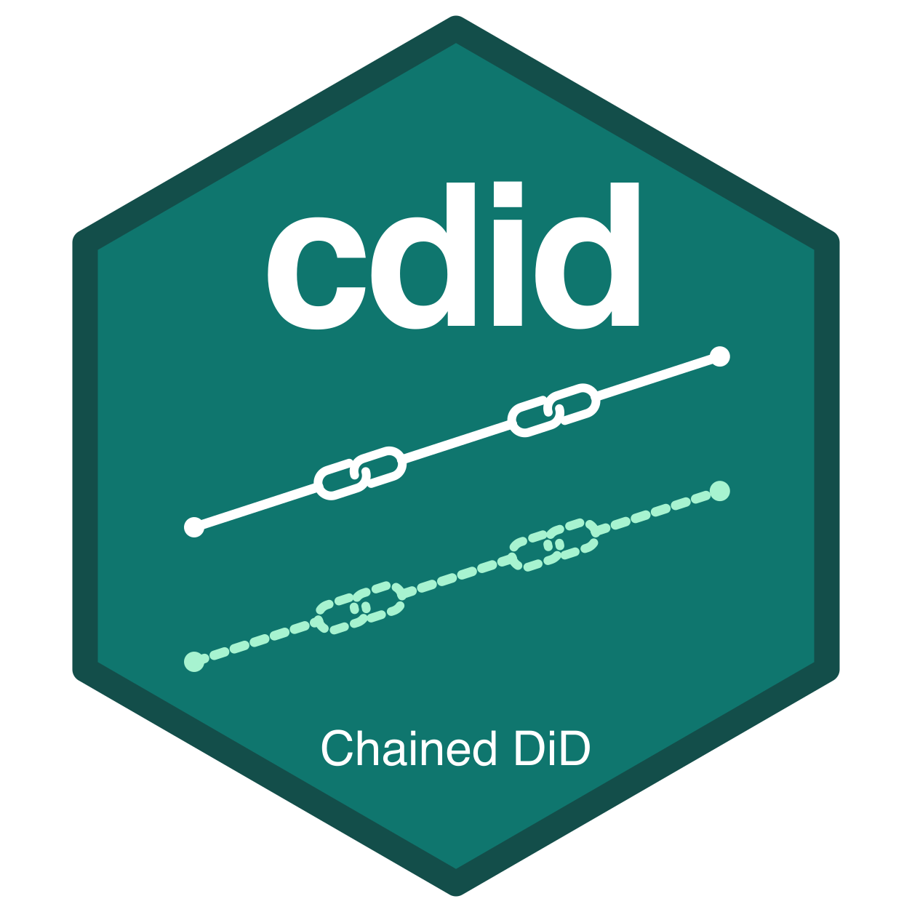

# cdid user guide 

Work through a first chained difference-in-differences fit, then prepare your panel, choose comparisons and adjustments, and interpret the results. The [package overview on GitHub](https://github.com/dvbn/cdid) has a runnable first example and the source installation requirements.

The guide describes R `cdid` 1.3.0.1. Numerical output on the article pages comes from recorded runs, and each page states the package versions it used. Analytical population values are labeled separately. The [release notes](../NEWS.md) list what each version added.

## Installation

The current [CRAN source release](https://cran.r-project.org/package=cdid) is 1.3.0.1. Run `install.packages("cdid")` and use `packageVersion("cdid")` to check your version. If your platform still installs an older binary, follow the [source installation instructions](https://github.com/dvbn/cdid#installation). For the Stata release, see the [Stata user guide](https://www.davidbenatia.com/tools/cdid/stata/).

## Get started

Start with the [worked fit](get-started.md) on a balanced panel. To use your own data, supply a unit identifier, a finite numeric date, a numeric outcome with missing values kept as `NA`, and a treatment column. For staggered adoption, the treatment column holds each unit's first treatment date, with 0 for units never treated. [Prepare your panel and unit table](help/prepare-data.md) gives the input checklist. [Investigate missingness and data structure](help/investigate-missingness.md) shows how to inspect who is observed at each date and which comparisons have support.

Each page of the reading path ends with links to the previous and next steps and a collapsible list of all steps.

## Reading path

The 22 steps below are numbered as on the pages themselves. The stage headings group them by the decision they support. Read Stage 1 in order. Later stages can be read when the decision arises.

### Stage 1. Make a first fit and understand what it estimates

| Step | Page | What you learn |
| --- | --- | --- |
| 1 | [Get started](get-started.md) | Main functions on a balanced panel: estimation, summaries, aggregation, plots and export. |
| 2 | [Moving from did](from-did.md) | What stays familiar, how incomplete panels are treated, and [why balanced results can differ and which to use](from-did.md#why-can-balanced-results-differ-and-which-should-i-use). |
| 3 | [Incomplete panels](examples/incomplete-panels.md) | Which changes an observation pattern supplies and how chaining combines them, with a rotating panel example. |
| 4 | [Identify effects when the observed units change composition](examples/identification.md) | When changes within units identify effects that comparisons of observed levels do not. |
| 5 | [How to compare precision](examples/precision.md) | Matched targets and assumptions, covariance, and what standard errors can show. |

### Stage 2. Prepare your data

| Step | Page | What you learn |
| --- | --- | --- |
| 6 | [Prepare your panel and unit table](help/prepare-data.md) | Identifiers, missing outcomes kept as `NA`, the unit table, changing covariates or weights, and [known reference covariate rows](help/prepare-data.md#add-a-known-reference-covariate-row) with `missing_reference`. |

### Stage 3. Adjust for treatment

| Step | Page | What you learn |
| --- | --- | --- |
| 7 | [Treatment adjustment](methods/treatment.md) | How IPW, OR and DR make a cohort comparable with its controls, and the [separate or pooled outcome regression](methods/treatment.md#outcome-regression-or). |
| 8 | [Choose IPW, OR or DR in an incomplete panel](examples/treatment-choice.md) | The three treatment adjustments compared on one incomplete panel. |

### Stage 4. Handle missing outcomes

| Step | Page | What you learn |
| --- | --- | --- |
| 9 | [Handling missing outcomes](methods/missing-outcomes.md) | The study population, the assumption about missing outcomes and the three ways to adjust for them. |
| 10 | [Sampling information for the observation model](methods/sampling-information.md) | Advanced: fitting the observation model on part of the unit table. |
| 11 | [Choose an observation model](examples/observation-models.md) | Date or pair logits, and how many slopes they share. |
| 12 | [Impute actual changes](examples/change-imputation.md) | Observation weighting, change imputation and the augmented correction compared on one panel. |

### Stage 5. Choose the parallel trends assumption and how comparisons are combined

| Step | Page | What you learn |
| --- | --- | --- |
| 13 | [Parallel trends](methods/parallel-trends.md) | PT-post, PT-all and the separate reporting choice `base_period`. |
| 14 | [Add PT-all restrictions](examples/pt-all-comparison.md) | What true and false PT-all restrictions change on one incomplete panel. |
| 15 | [GMM weighting and covariance regularization](methods/gmm.md) | How comparisons are combined and what covariance regularization does. |
| 16 | [Robustness](examples/robustness.md) | Which models must be correct for each combination of treatment adjustment and missing outcome handling. |

### Stage 6. Inference, reference and troubleshooting

| Step | Page | What you learn |
| --- | --- | --- |
| 17 | [Inference](examples/inference.md) | Intervals, bands, clustering, aggregation and pretrend tests. |
| 18 | [Options](reference/options.md) | Every argument with its default, accepted values and when it is active. |
| 19 | [Results](reference/results.md) | The contents of each result, the uncertainty rules, pretrend tests and export. |
| 20 | [Diagnose errors and unavailable results](help/troubleshooting.md) | Refused requests, failed fits, unavailable effects and surprising results. |

### Stage 7. Chain across cohorts with different observation windows

| Step | Page | What you learn |
| --- | --- | --- |
| 21 | [Cross-pair chaining, control parallel trends and within-unit weighting](methods/cross-pair-chaining.md) | `cross_pair = TRUE` when a cohort and its controls share no date pair, `pt_assumption = "ctrl"`, `gmm_weighting = "within"`, and `chain_report()` to see which comparisons identify an effect. |
| 22 | [Short pre-treatment windows](examples/short-pretreatment-windows.md) | Staggered cohorts observed only a few dates before adoption, and how chaining links their windows. |

## Choose the treatment design

The reading path uses the cohort model: `gname` holds each unit's adoption date, treatment is absorbing, and effects may evolve with time since adoption. The switching model and the linear fixed-effects specification also support the treatment and missing-outcome adjustments of Stages 3 and 4.

| Design | Page | What distinguishes it |
| --- | --- | --- |
| Binary treatment that can stop and restart | [When treatment can stop and restart](methods/static-entry-exit.md) | A static model without carryover: earlier treatment has no lingering effect beyond current status. Supply `dname`, the treatment status at every study date, including dates with missing outcomes. The result holds effects at entry and exit and a switcher-weighted average in `fit$aggregate`. `aggte()` does not apply. |
| Linear cohort-by-date fixed effects | [Cohort-by-date fixed effects](methods/cohort-time-fe.md) | A linear specification with unit fixed effects and a common untreated calendar path. Supply `gname` and `control = list(preset = "cohort_time_fe")`. The regression fit [matches R `etwfe` and Stata `jwdid`](methods/cohort-time-fe.md#match-r-etwfe-and-stata-jwdid) on the same inputs. |

Supplying both `gname` and `dname` is an error. Absorbing data supplied through `dname` still requests the static model and its targets. The [input requirements](methods/static-entry-exit.md#what-your-input-needs) of the switching model differ from the cohort route, and the [options reference](reference/options.md) marks which arguments apply to each.

## Compare with other software

- [Moving from did](from-did.md) explains chained versus ordinary mode and the added arguments.
- [Familiar DiD models for incomplete panels](comparisons.md) relates common specifications to chained estimation.
- [Reproduce R and Stata models](from-other-packages.md) shows how to match results from other packages.
- [Match R etwfe and Stata jwdid](methods/cohort-time-fe.md#match-r-etwfe-and-stata-jwdid) gives the commands and covariance conventions for the cohort-by-date preset.
- [Cross-pair chaining](methods/cross-pair-chaining.md) describes the settings that reproduce a stacked cohort fixed-effects benchmark.

## Hands-on notebook

The [practical notebook](../notebooks/README.md) covers the main workflows with editable synthetic examples: a first balanced fit, missing-outcome corrections, treatment adjustment, parallel trends and cross-pair chains, inference, pretrend tests, robustness, dated covariates, GMM diagnostics, the switching model and the cohort-by-date preset. Use the [editable Quarto source](../notebooks/cdid_practical_guide.qmd) to change the configuration and rerun, or [download the standalone HTML](https://github.com/dvbn/cdid/raw/refs/heads/main/notebooks/cdid_practical_guide.html) and open it in a browser to read the tables and plots without running R.

## Which page answers my question?

| Question | Where to look |
| --- | --- |
| An effect is reported as unavailable | [An effect is unavailable](help/troubleshooting.md#an-effect-is-unavailable) and the `available` and `support.reason` columns in [Tables from tidy and glance](reference/results.md#tables-from-tidy-and-glance). |
| A covariate is missing at a cohort's reference date | [Add a known reference covariate row](help/prepare-data.md#add-a-known-reference-covariate-row). The default `missing_reference = "exclude"` warns and restricts the affected cohort, and `"error"` stops and lists the inputs. |
| Should I use chained or ordinary mode on a balanced panel | [Why balanced results can differ and which to use](from-did.md#why-can-balanced-results-differ-and-which-should-i-use). |
| My treatment stops or restarts | [When treatment can stop and restart](methods/static-entry-exit.md). |
| My cohort and its controls never share a date pair | [Cross-pair chaining](methods/cross-pair-chaining.md), with `chain_report()` to inspect the comparisons that identify each effect. |
| Which models must be correct for my choice of adjustments | [Which models must be correct](methods/missing-outcomes.md#which-models-must-be-correct) and [Robustness](examples/robustness.md). |
| I want to see the fitted equations and coefficients | Set `control = list(keep_nuisance = TRUE)` and call `nuisance_models(fit)`. Section 8 of the [practical notebook](../notebooks/README.md) and [When treatment can stop and restart](methods/static-entry-exit.md) show the reports. |
| The pretrend test is unavailable | [Pretrend tests are unavailable](help/troubleshooting.md#pretrend-tests-are-unavailable). |
| I want the regression equivalent in R or Stata | [Match R etwfe and Stata jwdid](methods/cohort-time-fe.md#match-r-etwfe-and-stata-jwdid) and [Reproduce R and Stata models](from-other-packages.md). |
| A call stopped with a refusal | [Refusals](reference/options.md#refusals) lists the error classes, and [Diagnose errors](help/troubleshooting.md) explains what to check. |

## Terms used in this guide

| Term | Meaning |
| --- | --- |
| Study population | The population whose treatment effects the analysis describes. |
| Unit table | One row per study unit, supplied through the `frame` argument, including units with one or no observed outcomes. Without `frame`, the units present in `data` form it. |
| Treatment cohort | Units first treated in the same period. `gname` holds that period, and 0 marks units never treated. |
| Switchers and stayers | On the `dname` route, units whose treatment status changes at a date and units with the same prior status that keep it. Stayers are the comparison for that transition. |
| Units observed at both dates | The units whose outcomes are observed at both dates of a comparison. Only they contribute that change. |
| Treatment adjustment | How each cohort is made comparable with its controls: IPW, OR or DR, chosen with `est_method`. |
| Handling missing outcomes | The assumption made about missing outcomes and the way the package adjusts for them, chosen with the arguments that begin with `selection` and with `imputation_pooling`. |
| PT-post, PT-ctrl and PT-all | Parallel trends from each cohort's reference period onward, the same with common earlier trends among the clean control cohorts, and the same with common earlier trends for all cohorts from a chosen start date. |

## Questions and bug reports

Use [Issues](https://github.com/dvbn/cdid/issues) for questions about using the package or choosing a method and for reproducible bugs. Include the package version and a reproducible example.

See [Contributing](https://github.com/dvbn/cdid/blob/main/CONTRIBUTING.md) to suggest a change.

## Support the project

If cdid is useful to your work, you can [buy me a coffee](https://buymeacoffee.com/dvbn).
