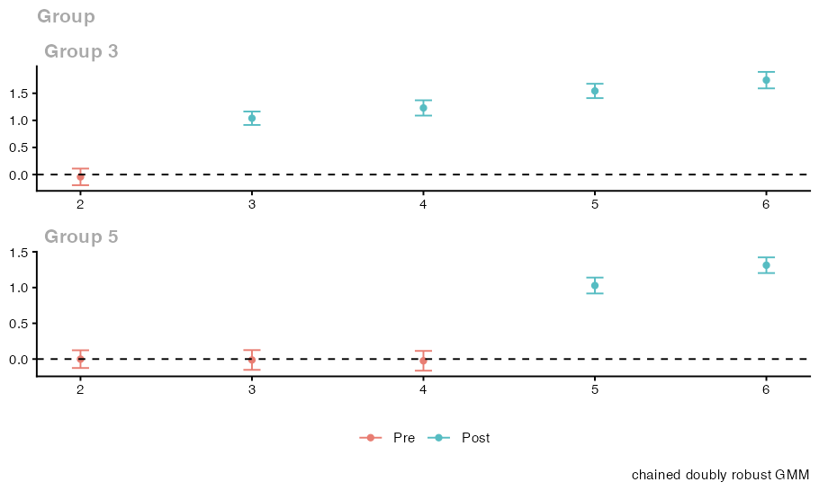
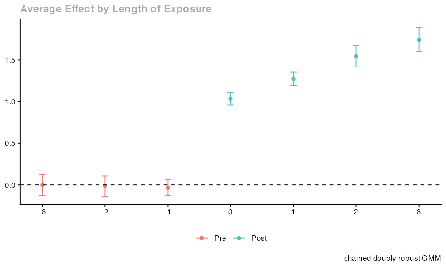

# Clustered inference, confidence bands, and pretrend tests

Results below were produced on October 29, 2026 with `cdid` 1.1.0.0, `did` 2.5.1 and `DRDID` 1.3.0 under R 4.5.2, using the displayed seeds where applicable. These are individual examples; they do not establish repeated-sample coverage.

After estimating group time average treatment effects on an incomplete panel, applied analyses typically need standard errors that account for within cluster dependence, simultaneous confidence bands across cells or event study horizons, and diagnostic pretrend tests. `cdid` builds on the chained difference in differences framework of Bellégo, Benatia and Dortet-Bernadet (2025) and the inference and aggregation workflow of Callaway and Sant'Anna (2021) (`did`), propagating complete unit table influence functions through every output without refitting the underlying models.

This article walks through a complete script on a clustered incomplete panel with staggered adoption, showing how to obtain clustered multiplier bootstrap standard errors and simultaneous bands in `att_gt()` and `aggte()`, inspect tidy tables and plots, and run both the unconditional Wald pretrend test and the separate conditional Cramér von Mises (`CvM`) pretrend test. For a complete list of result fields, see the [Results reference](../reference/results.md).

## Question

Suppose a longitudinal study follows $N = 2000$ units across $T = 6$ calendar dates in 100 regional clusters (`region`), with staggered treatment cohorts first treated at $G = 3$ and $G = 5$ alongside never treated controls ($G = 0$), a fixed binary covariate `x`, and missing outcomes generated by independent date observation. How do we compute clustered multiplier bootstrap standard errors and simultaneous confidence bands for group time effects and dynamic event study aggregates, distinguish pointwise intervals from joint bands across output families, and evaluate both unconditional and conditional pretrend tests?

## Data

### Study population, clusters, and staggered cohorts

The simulated study population consists of $N = 2000$ units recorded in the unit table `units` (`frame`), with one row per study unit and four columns: `id` ($1, \dots, 2000$), treatment cohort `g` in $\{0, 3, 5\}$ ($0$ for units never treated, $3$ and $5$ for cohorts first treated at $t = 3$ and $t = 5$), fixed binary covariate `x` ($\text{Bernoulli}(0.5)$ independent of `g` and `region`), and cluster identifier `region` ($1, \dots, 100$). Cohort assignment is independent of region, so clusters can mix cohorts, but a finite draw need not place every cohort in every cluster. The code checks overall cohort counts, not a within-cluster composition guarantee.

### Potential outcomes and cluster dependence

Across $T = 6$ calendar dates ($t \in \{1, 2, 3, 4, 5, 6\}$), untreated outcomes follow

$$Y_{i,t}(0) = \alpha_i + 0.1 t + 0.2 x_i t + u_{\text{region}(i)} t + \varepsilon_{i,t}$$

where $\alpha_i \sim \mathcal{N}(0, 1)$ is a unit intercept, $0.1 t + 0.2 x_i t$ is the mean untreated trend, $u_r \sim \mathcal{N}(0, 0.15^2)$ is a mean zero cluster trend slope shared within cluster $r$, and $\varepsilon_{i,t} \sim \mathcal{N}(0, 0.5^2)$ is idiosyncratic noise. Differencing within unit $i$ removes $\alpha_i$ but leaves $(t - s) u_{\text{region}(i)}$ in every outcome change $\Delta Y_{s,t}$, correlating outcome changes within the same `region`.

For treated units ($G \in \{3, 5\}$) at periods $t \ge G$, the treatment effect is $\tau(G, t) = 1 + 0.25 (t - G)$, which equals $1.00$ at event time $e = t - G = 0$, $1.25$ at $e = 1$, $1.50$ at $e = 2$, and $1.75$ at $e = 3$.

### Independent date observation with full panel rows retained

At each unit and date row, the outcome is observed independently with probability $0.8$ ($\text{Bernoulli}(0.8)$), independent of all potential outcomes, `g`, `x`, and `region`. All $N \times T = 12000$ unit and date rows are retained in `panel_data` with unobserved outcomes set to `NA`, keeping every calendar period in the stored calendar and aligned with `frame = units`.

## Assumptions

- **Representative pair observation (`selection = "none"`):** Because date observation is independent of potential outcomes, `g`, `x`, and `region`, the units observed at both endpoints of any date pair $(s, t)$ form a representative random subsample of each cohort in `units`. Setting `selection = "none"` is therefore justified without an observation model, and the target parameter remains the average treatment effect over the full study population $F$ in `frame = units` (retaining units observed once or never in cohort shares, cluster sums, and influence functions).
- **Parallel trends, no anticipation, and treatment DR:** With `control_group = "nevertreated"` and `anticipation = 0`, reference periods are $t = 2$ for $G = 3$ and $t = 4$ for $G = 5$. Because `g` and `x` are independent of the mean zero cluster slope $u_r$ and unit intercept $\alpha_i$, parallel trends hold from each cohort's reference period (`pt_assumption = "post"`, `PT-post`) and before treatment. With all six dates present in the stored calendar ($L(e) = t - s$), the conditional untreated change over pair $e$ is $(0.1 + 0.2 x) L(e)$, matching the pooled control regression $\alpha(b) + L(e) x \beta$ while the treatment propensity is constant in `x`.
- **Finite sample support and regularity:** In any single finite sample draw, random observation masks or covariate realizations can still produce empty cells, rank deficiency, or singular pretrend covariance matrices. The script checks basic cohort counts once without seed retry loops.

## Code


```r
set.seed(20261028)

N          <- 2000L
T_dates    <- 6L
n_clusters <- 100L

units <- data.frame(
  id     = seq_len(N),
  g      = sample(c(0L, 3L, 5L), size = N, replace = TRUE, prob = c(0.4, 0.3, 0.3)),
  x      = stats::rbinom(N, size = 1L, prob = 0.5),
  region = rep(seq_len(n_clusters), length.out = N)
)
stopifnot(all(table(factor(units$g, levels = c(0L, 3L, 5L))) > 0L))

alpha_i       <- stats::rnorm(N, mean = 0, sd = 1)
cluster_slope <- stats::rnorm(n_clusters, mean = 0, sd = 0.15)

panel_data <- expand.grid(time = seq_len(T_dates), id = units$id)
panel_data <- panel_data[order(panel_data$id, panel_data$time), c("id", "time")]
rownames(panel_data) <- NULL

panel_data$g      <- units$g[panel_data$id]
panel_data$x      <- units$x[panel_data$id]
panel_data$region <- units$region[panel_data$id]

treated_now <- panel_data$g > 0L & panel_data$time >= panel_data$g
effect <- ifelse(treated_now, 1 + 0.25 * (panel_data$time - panel_data$g), 0)

y_full <- alpha_i[panel_data$id] +
  0.1 * panel_data$time +
  0.2 * panel_data$x * panel_data$time +
  cluster_slope[panel_data$region] * panel_data$time +
  effect +
  stats::rnorm(nrow(panel_data), mean = 0, sd = 0.5)

observed <- stats::runif(nrow(panel_data)) < 0.8
panel_data$y <- ifelse(observed, y_full, NA_real_)

# Fit chained DiD with treatment DR, PT-post, varying base period, and clustering.
fit_inf <- cdid::att_gt(
  yname = "y", tname = "time", idname = "id", gname = "g",
  xformla = ~ x, data = panel_data, panel = TRUE,
  allow_unbalanced_panel = TRUE, control_group = "nevertreated",
  anticipation = 0, alp = 0.05, bstrap = TRUE, cband = TRUE,
  biters = 999, clustervars = "region", est_method = "dr",
  base_period = "varying", frame = units,
  selection = "none", pt_assumption = "post"
)

summary(fit_inf)
tidy_gt   <- cdid::tidy(fit_inf)
glance_gt <- cdid::glance(fit_inf)

fit_inf$W
fit_inf$Wpval
fit_inf$chained$pretest[c("status", "reason", "cells", "df", "W", "Wpval")]

# Dynamic event study aggregation and ggdid() plots.
agg_dyn <- cdid::aggte(fit_inf, type = "dynamic")
summary(agg_dyn)
tidy_dyn   <- cdid::tidy(agg_dyn)
glance_dyn <- cdid::glance(agg_dyn)
agg_dyn$overall.att
agg_dyn$overall.se
agg_dyn$chained$overall[c("status", "inference_kind", "ci_lower", "ci_upper")]

plot_gt  <- cdid::ggdid(fit_inf)
plot_dyn <- cdid::ggdid(agg_dyn)

# Separate conditional pretrend CvM test (takes data/route arguments directly,
# has no pt_assumption or gmm_weighting arguments, and defaults to est_method = "ipw").
pre_cond_dr <- cdid::conditional_did_pretest(
  yname = "y", tname = "time", idname = "id", gname = "g",
  xformla = ~ x, data = panel_data, panel = TRUE,
  allow_unbalanced_panel = TRUE, control_group = "nevertreated",
  alp = 0.05, bstrap = TRUE, cband = TRUE, biters = 999,
  clustervars = "region", est_method = "dr", anticipation = 0,
  base_period = "varying", frame = units, selection = "none"
)

summary(pre_cond_dr)
pre_cond_dr[c("CvM", "CvMcval", "CvMpval", "KS", "KSpval")]
pre_cond_dr$chained[c("status", "reason", "base_period")]

# Optional export calls (unexecuted):
# utils::write.csv(tidy_gt, file = "att_gt_tidy.csv", row.names = FALSE)
# ggplot2::ggsave("aggte_dynamic_plot.png", plot = plot_dyn, width = 7, height = 4)
# saveRDS(fit_inf, file = "fit_inf.rds")
```

<details>
<summary>Console output</summary>

```text
cdid chained difference-in-differences (chained doubly robust GMM): cdid_MP
  cdid 1.1.0.0 result built on did 2.5.1 (tested: did 2.5.1); did's MP methods tabulate the estimates below.
  Chained estimators: Bellego C., Benatia D. and V. Dortet-Bernadet (2025). "The Chained Difference-in-Differences." Journal of Econometrics 248, 105783. doi:10.1016/j.jeconom.2024.105783.
  Ordinary estimators: Callaway B. and P. H. C. Sant'Anna (2021). "Difference-in-Differences with Multiple Time Periods." Journal of Econometrics 225(2), 200-230. doi:10.1016/j.jeconom.2020.12.001.

Call:
cdid::att_gt(yname = "y", tname = "time", idname = "id", gname = "g", 
    xformla = ~x, data = panel_data, panel = TRUE, allow_unbalanced_panel = TRUE, 
    control_group = "nevertreated", anticipation = 0, alp = 0.05, 
    bstrap = TRUE, cband = TRUE, biters = 999, clustervars = "region", 
    est_method = "dr", base_period = "varying", frame = units, 
    selection = "none", pt_assumption = "post")

Group-Time Average Treatment Effects:
 Group Time ATT(g,t) Std. Error [95% Simult.  Conf. Band]  
     3    2  -0.0428     0.0565       -0.1962      0.1107  
     3    3   1.0394     0.0457        0.9153      1.1636 *
     3    4   1.2294     0.0519        1.0883      1.3705 *
     3    5   1.5430     0.0487        1.4106      1.6754 *
     3    6   1.7424     0.0560        1.5902      1.8945 *
     5    2  -0.0012     0.0457       -0.1252      0.1229  
     5    3  -0.0129     0.0509       -0.1511      0.1253  
     5    4  -0.0244     0.0509       -0.1628      0.1139  
     5    5   1.0284     0.0409        0.9172      1.1396 *
     5    6   1.3126     0.0404        1.2030      1.4223 *
---
Signif. codes: `*' confidence band does not cover 0

P-value for pre-test of parallel trends assumption:  0.867093175392542
Control Group:  Never Treated,  Anticipation Periods:  0
Estimation Method:  Doubly Robust

Chained support: 10 of 10 requested cells available.
  Units: 2000 in the unit table, 536 observed at all 6 dates, 1999 with at least two observed outcomes.
  Observation correction: none (selection = "none").
  Parallel trends: PT-post; base_period = "varying".
  GMM weighting: optimal (two-step); covariance regularization: not applied (moment covariance well conditioned).
  Inference: multiplier-bootstrap IQR standard errors (999 draws), clustered on 100 clusters (0 without eligible units); simultaneous band over the available cells.
  Parallel-trends pre-test: W = 1.26614, df = 4, p = 0.8671 (Wald test of all 4 pretrend cells jointly).
[1] 1.266143
[1] 0.8670932
$status
[1] "computed"

$<NA>
NULL

$cells
[1] "pre(g=3,t=2)" "pre(g=5,t=2)" "pre(g=5,t=3)" "pre(g=5,t=4)"

$df
[1] 4

$W
[1] 1.266143

$Wpval
[1] 0.8670932


cdid chained difference-in-differences (chained doubly robust GMM): cdid_AGGTEobj
  cdid 1.1.0.0 result built on did 2.5.1 (tested: did 2.5.1); did's AGGTEobj methods tabulate the estimates below.
  Chained estimators: Bellego C., Benatia D. and V. Dortet-Bernadet (2025). "The Chained Difference-in-Differences." Journal of Econometrics 248, 105783. doi:10.1016/j.jeconom.2024.105783.
  Ordinary estimators: Callaway B. and P. H. C. Sant'Anna (2021). "Difference-in-Differences with Multiple Time Periods." Journal of Econometrics 225(2), 200-230. doi:10.1016/j.jeconom.2020.12.001.

Call:
cdid::aggte(fit_inf, type = "dynamic")

Overall summary of ATT's based on event-study/dynamic aggregation:  
    ATT    Std. Error     [ 95%  Conf. Int.]  
 1.3978        0.0361      1.327      1.4687 *


Dynamic Effects:
 Event time Estimate Std. Error [95% Simult.  Conf. Band]  
         -3  -0.0012     0.0490       -0.1262      0.1238  
         -2  -0.0129     0.0480       -0.1354      0.1097  
         -1  -0.0333     0.0370       -0.1279      0.0612  
          0   1.0337     0.0290        0.9598      1.1077 *
          1   1.2723     0.0314        1.1923      1.3523 *
          2   1.5430     0.0498        1.4159      1.6701 *
          3   1.7424     0.0574        1.5958      1.8889 *
---
Signif. codes: `*' confidence band does not cover 0

Control Group:  Never Treated,  Anticipation Periods:  0
Estimation Method:  Doubly Robust

Chained dynamic aggregation: 7 of 7 intended aggregate(s) available; na.rm = FALSE.
  Overall summary: available over its 4 intended bins; pointwise interval.
  Parallel trends: PT-post; base_period = "varying".
  Inference: multiplier-bootstrap IQR standard errors (999 draws), clustered on 100 clusters (0 without eligible units); simultaneous band over the available estimates.
[1] 1.397846
[1] 0.0361435
$status
[1] "available"

$inference_kind
[1] "multiplier_bootstrap_iqr_se"

$ci_lower
[1] 1.327006

$ci_upper
[1] 1.468686

Chained conditional pretrend test (cdid, mode = "chained")
Cramer von Mises: 
  Test Statistic:  7.059199 
  Critical Value:  35.25377 
  P-value       :  0.7957958 
 
Cells (base_period = "varying"): pre(g=3,t=2), pre(g=5,t=2), pre(g=5,t=3), pre(g=5,t=4)
Multiplier draws: 999 on 100 clusters
Clustering on   :  region, 
X formula       :  ~x 
Note            : not the unconditional Wald test: att_gt()'s unconditional W/Wpval is separate and unchanged
$CvM
[1] 7.059199

$CvMcval
[1] 35.25377

$CvMpval
[1] 0.7957958

$KS
NULL

$KSpval
NULL

$status
[1] "available"

$reason
[1] NA

$base_period
[1] "varying"
```

</details>

## Interpretation

### Pointwise intervals versus simultaneous bands across output families

Following `did` 2.5.1, `bstrap` and `cband` govern these ATT and aggregation endpoints (the separate conditional test has its own rules below):

| `bstrap` | `cband` | Group time cells of `att_gt()` | Scalar `aggte()` simple and `overall.att` summaries | Separate bins (`att.egt`) of `aggte()` group, dynamic, and calendar |
| --- | --- | --- | --- | --- |
| `FALSE` | `FALSE` | Analytical SEs, pointwise normal intervals | Analytical SE, pointwise normal interval | Analytical SEs, pointwise normal intervals |
| `TRUE` | `FALSE` | Multiplier SEs, pointwise normal intervals | Multiplier SE, pointwise normal interval | Multiplier SEs, pointwise normal intervals |
| `TRUE` | `TRUE` | Multiplier SEs, simultaneous band over available cells | Multiplier SE, pointwise normal interval | Multiplier SEs, simultaneous band over available bins |
| `FALSE` | `TRUE` | Analytical SEs, pointwise normal intervals, zero draws | Analytical SE, pointwise normal interval, zero draws | Analytical SEs with a multiplier simultaneous critical value and `did`'s warning |

The table describes supported nondegenerate families. Empty or exactly zero families can need no draws; inspect the recorded effective flags and count. “Zero draws” for a scalar overall endpoint does not mean a nontrivial aggregation call made no draws for its separate-bin band.

Three distinctions matter when reading `tidy_gt`, `tidy_dyn`, and `ggdid()` plots:

1. **Band columns versus pointwise columns:** With `bstrap = TRUE, cband = TRUE`, `conf.low` and `conf.high` in `tidy_gt` (and `fit_inf$chained$cband_lower`, `cband_upper`) form a simultaneous band over the available cells of `fit_inf` using critical value `fit_inf$c`. By contrast, `p.value` is always pointwise, and `point.conf.low` and `point.conf.high` (and `fit_inf$chained$ci_lower`, `ci_upper`) are always pointwise normal intervals using `qnorm(1 - alp / 2)`.
2. **Event study bins versus scalar overall summaries:** In `agg_dyn`, the separate event time estimates (`agg_dyn$att.egt`, appearing as `estimate` with `event.time` in `tidy_dyn` and plotted by `ggdid(agg_dyn)`) receive a simultaneous band across the available event times using `agg_dyn$crit.val.egt`. Meanwhile, the scalar posttreatment summary `agg_dyn$overall.att` (`agg_dyn$overall.se`, with interval `agg_dyn$chained$overall$ci_lower`, `ci_upper`) always uses a pointwise normal critical value, just like `aggte(..., type = "simple")`.
3. **Separate output families are not one global band:** `fit_inf`, `agg_dyn`, group or calendar aggregations, and any optional basis contrasts each form their own `band_family`; they do not form a single simultaneous band over their union.

### How the clustered multiplier bootstrap and influence functions work

- **No resampling or refitting:** `fit_inf$inffunc` is a matrix with one row per unit in `units` (`frame`, $n = 2000$). `agg_dyn$inf.function` is a list: `dynamic.inf.func.e` is the full-unit by event-bin matrix and `dynamic.inf.func` is the full-unit vector for the overall summary. Both retain units observed once or never. They include the estimation uncertainty of all active nuisance models (treatment propensity logits, the pooled counterfactual regression, and when active, observation or imputation models), empirical response rates, and estimated cohort shares in `aggte()`.
- **Clustered row sums and Rademacher draws:** With `clustervars = "region"`, influence function rows are summed within each of the 100 clusters (including clusters with no observed changes). For a supported nondegenerate family, the requested `biters = 999` draws multiply each cluster sum by a Rademacher sign ($\pm 1$) from the session RNG stream (`set.seed()` reproduces them).
- **Interquartile scale and symmetric intervals:** Multiplier standard errors use the draw interquartile range divided by the standard normal interquartile range, converted to the scale of the estimate, and bands take the symmetric form $\text{estimate} \pm c \times \text{SE}$ (never percentile intervals).
- **Clustering never changes point estimates:** Feasible two step GMM weights (`gmm_weighting = "optimal"`) and any Tikhonov covariance ridge (`gmm_covariance = "tikhonov"`) use unit level influence function covariances independently of `clustervars`. Analytical standard errors use the estimated sandwich covariance of the complete target influence functions; multiplier standard errors use IQR scales from draws of those functions. Neither uses the inverse regularized criterion matrix as its variance estimate.

### Unconditional Wald test versus conditional CvM pretrend test

| Feature | Unconditional Wald test (`att_gt()`) | Conditional Cramér von Mises test (`conditional_did_pretest()`) |
| --- | --- | --- |
| Call and arguments | Computed inside `cdid::att_gt()`; uses `att_gt()`'s `est_method = "dr"` default | Separate call taking data and route arguments directly (not passed `fit_inf`); has **no** `pt_assumption`, `pt_start`, `gmm_weighting`, or `gmm_covariance` arguments; defaults to `est_method = "ipw"` unless overridden |
| Null hypothesis | Jointly tests that all nonreference preperiod cells (`role == "pre"`) of `base_period` equal zero unconditionally | Tests that for every nonreference preperiod cell of `base_period`, the conditional mean comparison given the `xformla` design at the cell's earlier date is zero across the full unit table grid |
| Stored fields and status string | `fit_inf$W`, `fit_inf$Wpval`, and `fit_inf$chained$pretest$status` (`"computed"`, `"unavailable"`, `"not_applicable"`, or `"not_computed"`) | `pre_cond_dr$CvM`, `CvMb`, `CvMcval`, `CvMpval` (`KS`, `KSb`, `KScval`, `KSpval` are `NULL`), and `pre_cond_dr$chained$status` (`"available"`, `"unavailable"`, or `"not_applicable"`) |
| Availability requirements | Requires **every** declared preperiod cell and a well conditioned joint covariance; never substitutes an available subset | Requires **every** declared preperiod cell and complete `xformla` covariates on **every** unit table row (even units contributing no outcome changes); otherwise returns `status = "unavailable"` with `NA` statistics |

### Finite sample, cluster count, and pretest caveats

- **Large sample cluster requirements:** Analytical and multiplier inference require enough independent clusters (or units), overlap, and regularity conditions; dividing units across only a few clusters does not supply enough independent clusters, and `cdid` makes no finite sample or few cluster coverage guarantee.
- **Full-null rank requirement:** Centered influence sums from `C` independent clusters have covariance rank at most `C - 1`. A Wald test with more declared restrictions is unavailable even if rounding produces positive Cholesky pivots. The same bound applies to centered unit influence rows without clustering. No restrictions are removed, and point estimates and their other inference remain available.
- **Single draw outcomes and pretest limits:** A single simulated sample is not guaranteed to pass the Wald or `CvM` test, and finite sample support or rank failures remain possible. Conversely, failing to reject a pretrend test does not prove parallel trends, which also restrict posttreatment counterfactual trends ([Parallel trends](../methods/parallel-trends.md#pretrend-tests-under-each-choice)).

## Next steps

- Read the [Results reference](../reference/results.md), [Options reference](../reference/options.md), and [Parallel trends](../methods/parallel-trends.md).
- Compare model specifications in [Compare model robustness across treatment and missing outcome adjustments](robustness.md) and [Estimate treatment effects from incomplete panels](incomplete-panels.md).







---

**Reading path, step 17 of 20** · Previous: [Robustness](robustness.md) · Next: [Options](../reference/options.md)

<details>
<summary>All steps of the reading path</summary>

| Step | Page |
| --- | --- |
| 1 | [Get started](../get-started.md) |
| 2 | [Moving from did](../from-did.md) |
| 3 | [Incomplete panels](incomplete-panels.md) |
| 4 | [Identify effects when the observed units change composition](identification.md) |
| 5 | [How to compare precision](precision.md) |
| 6 | [Prepare your panel and unit table](../help/prepare-data.md) |
| 7 | [Treatment adjustment](../methods/treatment.md) |
| 8 | [Choose IPW, OR or DR in an incomplete panel](treatment-choice.md) |
| 9 | [Handling missing outcomes](../methods/missing-outcomes.md) |
| 10 | [Sampling information for the observation model](../methods/sampling-information.md) |
| 11 | [Choose an observation model](observation-models.md) |
| 12 | [Impute actual changes](change-imputation.md) |
| 13 | [Parallel trends](../methods/parallel-trends.md) |
| 14 | [Add PT-all restrictions](pt-all-comparison.md) |
| 15 | [GMM weighting and covariance regularization](../methods/gmm.md) |
| 16 | [Robustness](robustness.md) |
| 17 | **Inference** (this page) |
| 18 | [Options](../reference/options.md) |
| 19 | [Results](../reference/results.md) |
| 20 | [Diagnose errors and unavailable results](../help/troubleshooting.md) |

[Guide home](../README.md) · [Package overview](../../README.md)

</details>
