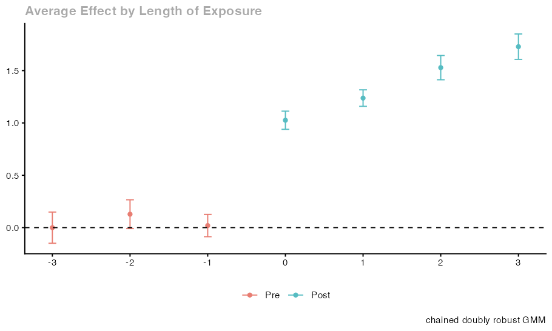

# Choose IPW, OR or DR in an incomplete panel

Results below were produced on October 29, 2026 with `cdid` 1.1.0.0, `did` 2.5.1 and `DRDID` 1.3.0 under R 4.5.2, using the displayed seeds where applicable. These are individual examples; they do not establish repeated-sample coverage.

In chained difference in differences (`cdid`, extending Bellégo, Benatia and Dortet-Bernadet 2025 and Callaway and Sant'Anna 2021), `est_method` selects the **treatment adjustment** method: inverse probability weighting (IPW, `"ipw"`), outcome regression (OR, `"reg"`), or doubly robust estimation (DR, `"dr"`). That choice is separate from **handling missing outcomes** (`selection` and `selection_est_method`), which governs how observed outcome changes represent the study population in the unit table (`frame`).

This worked example compares IPW, OR, and DR on the same incomplete panel, study population, and target effects, holding `selection = "none"`, `control_group = "nevertreated"`, `pt_assumption = "post"`, `base_period = "varying"`, and the inference flags fixed. [Add PT-all restrictions](pt-all-comparison.md) reuses the exact panel and unit table generated here.

## Question

When an incomplete panel tracks a study population in a unit table (`frame`) with a baseline covariate `x` that shifts both cohort membership and untreated outcome trends, and missingness is independent of covariates, cohort, and potential outcomes, how do `est_method = "ipw"`, `est_method = "reg"`, and `est_method = "dr"` compare on the same data, why does this data generating law satisfy both the treatment propensity model and the shared counterfactual outcome regression, and how should an analyst choose among them in practice?

## Data

Consider a study population of $N = 2000$ units in `units` (`frame`) across $T = 6$ stored calendar dates $t \in \{1, 2, 3, 4, 5, 6\}$. Each unit $i$ has an independent baseline covariate $X_i \sim \text{Uniform}(-1, 1)$. Cohort $G_i \in \{0, 3, 5\}$ (`first_treat`) is assigned by multinomial weights $1$ for never treated controls ($G_i = 0$), $\text{odds}_3(X_i) = \exp(0.2 + 0.6 X_i)$ for cohort $3$, and $\text{odds}_5(X_i) = \exp(-0.2 - 0.4 X_i)$ for cohort $5$. With $\text{total}(X_i) = 1 + \text{odds}_3(X_i) + \text{odds}_5(X_i)$, a uniform draw $U_i \sim \text{Uniform}(0, 1)$ allocates unit $i$ with probabilities $p_3(X_i) = \text{odds}_3(X_i) / \text{total}(X_i)$, $p_5(X_i) = \text{odds}_5(X_i) / \text{total}(X_i)$, and $p_0(X_i) = 1 / \text{total}(X_i)$.

Untreated potential outcomes at date $t \in \{1, \dots, 6\}$ are $Y_{i,t}(0) = \alpha_i + 0.1 t + 0.3 X_i t + \varepsilon_{i,t}$, with independent unit effect $\alpha_i \sim \mathcal{N}(0, 1)$ and shock $\varepsilon_{i,t} \sim \mathcal{N}(0, 0.5^2)$ independent of $(G_i, X_i, \alpha_i)$. Actual latent outcomes are $Y_{i,t} = Y_{i,t}(0) + \mathbf{1}\{G_i > 0, t \ge G_i\}(1 + 0.25(t - G_i))$. No anticipation holds ($\text{anticipation} = 0$). For posttreatment dates $t \ge g$ of cohort $g \in \{3, 5\}$, the population target is $\text{ATT}(g, t) = 1 + 0.25(t - g)$, and the dynamic event time target at $e = t - g \ge 0$ is the same function $1 + 0.25 e$.

Each unit and date outcome is observed independently with probability $0.5$. The panel `panel` retains all $N \times T = 12000$ rows across dates $1$ to $6$ with `NA` in `y` when unobserved, and `units` retains one row per study unit (`id`, `first_treat`, `x`), including units with zero or one observed outcome.

## Assumptions

The three fits vary only `est_method` ([Options](../reference/options.md)).

| Argument | Setting | Purpose |
| --- | --- | --- |
| `yname`, `tname`, `idname`, `gname` | `"y"`, `"period"`, `"id"`, `"first_treat"` | Outcome, stored calendar date ($1$ to $6$), unit ID, and cohort ($0, 3, 5$). |
| `xformla`, `data`, `frame` | `~ x`, `panel`, `units` | Covariate design, $N \times T$ panel with `NA` outcomes, and $N$ row unit table ([Options](../reference/options.md#chained-arguments)). |
| `control_group`, `est_method` | `"nevertreated"`, `"ipw"` / `"reg"` / `"dr"` | Compares treated cohorts with $G_i = 0$ across IPW, OR, and DR ([Treatment adjustment](../methods/treatment.md)). |
| `selection`, `pt_assumption`, `base_period` | `"none"`, `"post"`, `"varying"` | Representative observed pair changes, `PT-post`, and consecutive preperiod reports ([Parallel trends](../methods/parallel-trends.md)). |
| `bstrap`, `cband`, `compute_inffunc` | `FALSE`, `FALSE`, `TRUE` | Analytical standard errors, pointwise normal intervals, and complete unit influence functions ([Options](../reference/options.md#inference-and-computation)). |

### Why this law satisfies both treatment models and baseline missingness

Passing `xformla = ~ x` to IPW and OR does not automatically make both models match the population law: IPW fits risk set cohort logits, whereas OR fits one pooled regression of control outcome changes across all comparison blocks ([Treatment adjustment](../methods/treatment.md)). Here both hold by construction:

1. **Cancellation of $\alpha_i$ and conditional parallel trends:** Differencing across any stored calendar pair $e = (s, t)$ with $s < t$ cancels $\alpha_i$, giving $Y_{i,t}(0) - Y_{i,s}(0) = 0.1(t - s) + 0.3 X_i (t - s) + (\varepsilon_{i,t} - \varepsilon_{i,s})$. Since $\varepsilon_{i,t}$ has mean zero given $(G_i, X_i)$, conditional parallel trends hold at all dates $1$ to $6$.
2. **Representative baseline missingness (`selection = "none"`):** Because observation has probability $0.5$ independently of $(G_i, X_i, \alpha_i, \varepsilon_{i,t})$, observed pair changes within each cohort are mean representative of that cohort in `units`. The estimator uses empirical cohort pair response rates without fitting an observation model; this is not an exact finite sample recovery of the population mean change ([Handling missing outcomes](../methods/missing-outcomes.md)).
3. **Correct pairwise treatment propensity logits ($p$):** Conditioning on $G_i \in \{3, 0\}$, the odds of cohort $3$ versus never treated controls are $p_3(X_i) / p_0(X_i) = \exp(0.2 + 0.6 X_i)$, with linear log odds $0.2 + 0.6 X_i$. Conditioning on $G_i \in \{5, 0\}$, the odds of cohort $5$ versus never treated controls are $p_5(X_i) / p_0(X_i) = \exp(-0.2 - 0.4 X_i)$, with linear log odds $-0.2 - 0.4 X_i$. Compact support $X_i \in [-1, 1]$ bounds the population probabilities away from 0 and 1. The independent observation mask preserves these linear odds in observed pair populations; multiplying by cohort specific response-rate constants can change the intercept, without introducing nonlinear terms in $X_i$. This does not guarantee support or a finite logit root in a realized sample.
4. **Correct shared counterfactual outcome regression ($m$):** With all dates $1, \dots, 6$ stored, the calendar step count is $L(e) = t - s$. The control mean change is $E[Y_{i,t}(0) - Y_{i,s}(0) \mid X_i, G_i = 0] = 0.1 L(e) + 0.3 L(e) X_i$, matching `cdid`'s single pooled control regression $m_b(X_i) = \alpha(b) + L(e) X_i \beta$ with local block intercept $\alpha(b) = 0.1 L(e)$ and shared global slope $\beta = 0.3$ (`n_regression_fits = 1`).
5. **Why `"notyettreated"` alters the pooled odds:** For cohort $3$ before period $5$, `"notyettreated"` pools $G_i = 0$ and $G_i = 5$. Under this multinomial law, the odds of $G_i = 3$ against $G_i \in \{0, 5\}$ are $\exp(0.2 + 0.6 X_i) / (1 + \exp(-0.2 - 0.4 X_i))$, whose log odds are nonlinear in $X_i$. Linear pairwise log odds against `nevertreated` do not imply linear risk set log odds for a `notyettreated` mixture. This is a model specification issue for that mixture, rather than a claim that NYT by itself forces a difference between `cdid` and `did`. The distinct fixed-horizon control-pool moments retained by chained estimation are explained in [Moving from did](../from-did.md#a-balanced-nyt-example).

## Code


```r
set.seed(20261028)
n_units <- 2000L
n_periods <- 6L

x <- stats::runif(n_units, min = -1, max = 1)
odds3 <- exp(0.2 + 0.6 * x)
odds5 <- exp(-0.2 - 0.4 * x)
total_weight <- 1 + odds3 + odds5
p3 <- odds3 / total_weight
p5 <- odds5 / total_weight
p0 <- 1 / total_weight

u_cohort <- stats::runif(n_units)
first_treat <- ifelse(u_cohort < p3, 3L, ifelse(u_cohort < p3 + p5, 5L, 0L))

units <- data.frame(id = seq_len(n_units), first_treat = first_treat, x = x)
panel <- data.frame(
  id = rep(units$id, each = n_periods),
  period = rep(seq_len(n_periods), times = n_units),
  first_treat = rep(units$first_treat, each = n_periods),
  x = rep(units$x, each = n_periods)
)

alpha <- stats::rnorm(n_units, mean = 0, sd = 1)
eps <- stats::rnorm(nrow(panel), mean = 0, sd = 0.5)
y0 <- rep(alpha, each = n_periods) + 0.1 * panel$period + 0.3 * panel$x * panel$period + eps
treated_now <- panel$first_treat > 0L & panel$period >= panel$first_treat
effect <- ifelse(treated_now, 1 + 0.25 * (panel$period - panel$first_treat), 0)

y_complete <- y0 + effect
observed <- stats::runif(nrow(panel)) < 0.5
panel$y <- ifelse(observed, y_complete, NA_real_)

methods <- c(ipw = "ipw", or = "reg", dr = "dr")
fits <- lapply(methods, function(m) {
  cdid::att_gt(
    yname = "y", tname = "period", idname = "id", gname = "first_treat",
    xformla = ~ x, data = panel, frame = units,
    control_group = "nevertreated", est_method = m, selection = "none",
    pt_assumption = "post", base_period = "varying", bstrap = FALSE, cband = FALSE
  )
})

common_cols <- c("target.id", "group", "time", "role", "available", "estimate", "std.error")
cell_tables <- Map(function(fit, method_name) {
  tab <- cdid::tidy(fit)[, common_cols]
  tab$method <- method_name
  tab$estimator_label <- fit$chained$estimator
  tab$population_truth <- ifelse(tab$role == "post", 1 + 0.25 * (tab$time - tab$group), 0)
  tab
}, fits, names(fits))
per_cell_comparison <- do.call(rbind, cell_tables)
per_cell_comparison[per_cell_comparison$role == "post", ]

dynamic_fits <- lapply(fits, cdid::aggte, type = "dynamic")
dynamic_comparison <- do.call(rbind, Map(function(agg, method_name) {
  data.frame(
    method = method_name, event_time = agg$egt,
    estimate = agg$att.egt, std.error = agg$se.egt,
    population_truth = ifelse(agg$egt >= 0, 1 + 0.25 * agg$egt, 0)
  )
}, dynamic_fits, names(dynamic_fits)))
dynamic_comparison

gt_plots <- lapply(fits, cdid::ggdid)
dynamic_plots <- lapply(dynamic_fits, cdid::ggdid)
```

<details>
<summary>Console output</summary>

```text
target.id group time role available estimate  std.error method
ipw.2  ATT(g=3,t=3)     3    3 post      TRUE 1.011155 0.05960259    ipw
ipw.3  ATT(g=3,t=4)     3    4 post      TRUE 1.305540 0.06123456    ipw
ipw.4  ATT(g=3,t=5)     3    5 post      TRUE 1.538407 0.05912689    ipw
ipw.5  ATT(g=3,t=6)     3    6 post      TRUE 1.744085 0.06290892    ipw
ipw.9  ATT(g=5,t=5)     5    5 post      TRUE 1.053864 0.06549822    ipw
ipw.10 ATT(g=5,t=6)     5    6 post      TRUE 1.139585 0.06709454    ipw
or.2   ATT(g=3,t=3)     3    3 post      TRUE 1.022526 0.05780193     or
or.3   ATT(g=3,t=4)     3    4 post      TRUE 1.290286 0.05976722     or
or.4   ATT(g=3,t=5)     3    5 post      TRUE 1.529845 0.05911358     or
or.5   ATT(g=3,t=6)     3    6 post      TRUE 1.723973 0.06180484     or
or.9   ATT(g=5,t=5)     5    5 post      TRUE 1.047170 0.06530943     or
or.10  ATT(g=5,t=6)     5    6 post      TRUE 1.136599 0.06704396     or
dr.2   ATT(g=3,t=3)     3    3 post      TRUE 1.007945 0.05946479     dr
dr.3   ATT(g=3,t=4)     3    4 post      TRUE 1.298627 0.06084339     dr
dr.4   ATT(g=3,t=5)     3    5 post      TRUE 1.528495 0.05908227     dr
dr.5   ATT(g=3,t=6)     3    6 post      TRUE 1.728774 0.06184471     dr
dr.9   ATT(g=5,t=5)     5    5 post      TRUE 1.053470 0.06544368     dr
dr.10  ATT(g=5,t=6)     5    6 post      TRUE 1.143902 0.06712190     dr
                                   estimator_label population_truth
ipw.2                              chained IPW-GMM             1.00
ipw.3                              chained IPW-GMM             1.25
ipw.4                              chained IPW-GMM             1.50
ipw.5                              chained IPW-GMM             1.75
ipw.9                              chained IPW-GMM             1.00
ipw.10                             chained IPW-GMM             1.25
or.2   chained outcome regression/control-mean GMM             1.00
or.3   chained outcome regression/control-mean GMM             1.25
or.4   chained outcome regression/control-mean GMM             1.50
or.5   chained outcome regression/control-mean GMM             1.75
or.9   chained outcome regression/control-mean GMM             1.00
or.10  chained outcome regression/control-mean GMM             1.25
dr.2                     chained doubly robust GMM             1.00
dr.3                     chained doubly robust GMM             1.25
dr.4                     chained doubly robust GMM             1.50
dr.5                     chained doubly robust GMM             1.75
dr.9                     chained doubly robust GMM             1.00
dr.10                    chained doubly robust GMM             1.25
      method event_time      estimate  std.error population_truth
ipw.1    ipw         -3 -0.0036005082 0.07624331             0.00
ipw.2    ipw         -2  0.1276100192 0.07024728             0.00
ipw.3    ipw         -1  0.0207240855 0.05430503             0.00
ipw.4    ipw          0  1.0279996411 0.04434251             1.00
ipw.5    ipw          1  1.2400861096 0.04047772             1.25
ipw.6    ipw          2  1.5384065010 0.05912689             1.50
ipw.7    ipw          3  1.7440852287 0.06290892             1.75
or.1      or         -3  0.0099445749 0.07412692             0.00
or.2      or         -2  0.1330753901 0.07008427             0.00
or.3      or         -1  0.0213751385 0.05350763             0.00
or.4      or          0  1.0322457015 0.04343659             1.00
or.5      or          1  1.2296705225 0.03912655             1.25
or.6      or          2  1.5298454025 0.05911358             1.50
or.7      or          3  1.7239726289 0.06180484             1.75
dr.1      dr         -3 -0.0003672074 0.07605146             0.00
dr.2      dr         -2  0.1281262590 0.07029130             0.00
dr.3      dr         -1  0.0193646340 0.05420753             0.00
dr.4      dr          0  1.0259005597 0.04426626             1.00
dr.5      dr          1  1.2376021460 0.04021797             1.25
dr.6      dr          2  1.5284947291 0.05908227             1.50
dr.7      dr          3  1.7287739283 0.06184471             1.75
```

</details>

## Result

Each entry in `fits` is a `cdid_MP` object ([Results](../reference/results.md#group-time-results)). In `per_cell_comparison` and `dynamic_comparison`, `population_truth` records the known population parameter, kept distinct from sample estimates (`estimate`) and analytical standard errors (`std.error`):

- Cohort $3$ posttreatment cells $(3, 3), (3, 4), (3, 5), (3, 6)$ at event times $e = 0, 1, 2, 3$ have population truth $1.00, 1.25, 1.50, 1.75$; cohort $5$ cells $(5, 5), (5, 6)$ at $e = 0, 1$ have truth $1.00, 1.25$.
- `fit$chained$estimator` is documented on every chained fit, whereas `cdid::tidy(fit)` includes the optional `estimator` column for OR and DR fits and for imputation or augmented missing outcome routes. Selecting `common_cols` avoids assuming identical optional tidy columns across methods.
- `fit$n` equals $2000$ for all three fits because `frame = units` keeps every study unit in `fit$inffunc` and in cohort shares.

## Interpretation

### Why finite sample estimates can differ across IPW, OR, DR, and `did`

Even when both $p$ and $m$ are correct in the population, IPW, OR, and DR solve different sample equations before two step GMM combination: IPW uses normalized Hajek weights from risk set logits, OR subtracts predictions $\hat{\alpha}(b) + L(e) X_i \hat{\beta}$ from one pooled control regression across all blocks, and DR applies IPW to the control regression residuals ([Treatment adjustment](../methods/treatment.md#doubly-robust-treatment-estimation-dr)). Their finite sample estimates and standard errors can therefore differ. Covariate imbalance does not force a difference: fitted corrections can coincide or cancel in particular samples.

Passing the same `xformla = ~ x` formula to `cdid` and `did` likewise does not imply identical finite sample OR or DR estimates: `cdid` pools control changes across blocks with one shared duration scaled slope $L(e) z(X_i)' \beta$ and combines links by GMM, whereas `did` fits period pair regressions separately. If the full fitted procedure coincides, including coefficient restrictions, nuisance fitting, retained comparisons and weights, point estimates should agree up to numerical rounding; method labels alone establish neither equality nor a difference. With incomplete outcomes and explicit `allow_unbalanced_panel = TRUE`, ordinary mode uses `did`'s RCS routines based on levels. With `FALSE` or its ordinary mode default, it instead keeps complete cases and estimates changes within units. Each route has its own sampling conditions; the independent mask here is compatible with them, but their fitted constructions differ. Use `mode = "ordinary"` when exact `did` behavior is required ([Moving from did](../from-did.md#why-can-balanced-results-differ-and-which-should-i-use)).

### Practical choice among IPW, OR, and DR

- **IPW (`est_method = "ipw"`):** Needs a credible risk set treatment logit $p$ and strict overlap for every active comparison, while leaving period specific covariate effects on untreated changes unrestricted.
- **OR (`est_method = "reg"`):** Needs a credible shared control change regression $m$ with constant per step slope $\beta$ on $L(e) z(X_i)$ across all pooled blocks, without fitting treatment logits. Misspecification in one block can move $\hat{\beta}$ everywhere.
- **DR (`est_method = "dr"`, default):** Consistent for each comparison if either $p$ or $m$ is correct, under valid missing outcome handling, parallel trends, no anticipation, overlap and the usual large sample regularity conditions. Both active fits must still satisfy their computation and support checks. If an active treatment logit separates or is rank deficient, or if the reduced pooled control design remains rank deficient, is badly conditioned or fails required prediction reconstruction, `cdid` stops with an explicit error rather than falling back to OR or IPW. Exact aliases can first be removed when every required prediction is preserved; local rank deficiency alone need not invalidate a pooled fit.

There is no general finite sample unbiasedness guarantee for IPW, OR, or DR, and none is guaranteed to have the lowest variance across all designs. In any random finite draw, unsupported cells (`available == FALSE`), unavailable Wald pretrend tests (`fit$W`, `fit$Wpval`), or numerical and conditioning refusals remain possible without automatic retry, redraw, or dropping of units or moments. See [Robustness](robustness.md) and [How to compare precision](precision.md).

## Next step

- Keep `units`, `panel`, `y_complete`, and `observed` in your R session and continue to [Add PT-all restrictions](pt-all-comparison.md), [Treatment adjustment](../methods/treatment.md), [Options](../reference/options.md), and [Results](../reference/results.md).

## References

- Bellégo, C., Benatia, D. and Dortet-Bernadet, V. (2025). The Chained Difference-in-Differences. *Journal of Econometrics*. https://doi.org/10.1016/j.jeconom.2024.105783
- Callaway, B. and Sant'Anna, P. H. C. (2021). Difference-in-Differences with Multiple Time Periods. *Journal of Econometrics* 225(2). https://doi.org/10.1016/j.jeconom.2020.12.001




---

**Reading path, step 8 of 20** · Previous: [Treatment adjustment](../methods/treatment.md) · Next: [Handling missing outcomes](../methods/missing-outcomes.md)

<details>
<summary>All steps of the reading path</summary>

| Step | Page |
| --- | --- |
| 1 | [Get started](../get-started.md) |
| 2 | [Moving from did](../from-did.md) |
| 3 | [Incomplete panels](incomplete-panels.md) |
| 4 | [Identify effects when the observed units change composition](identification.md) |
| 5 | [How to compare precision](precision.md) |
| 6 | [Prepare your panel and unit table](../help/prepare-data.md) |
| 7 | [Treatment adjustment](../methods/treatment.md) |
| 8 | **Choose IPW, OR or DR in an incomplete panel** (this page) |
| 9 | [Handling missing outcomes](../methods/missing-outcomes.md) |
| 10 | [Sampling information for the observation model](../methods/sampling-information.md) |
| 11 | [Choose an observation model](observation-models.md) |
| 12 | [Impute actual changes](change-imputation.md) |
| 13 | [Parallel trends](../methods/parallel-trends.md) |
| 14 | [Add PT-all restrictions](pt-all-comparison.md) |
| 15 | [GMM weighting and covariance regularization](../methods/gmm.md) |
| 16 | [Robustness](robustness.md) |
| 17 | [Inference](inference.md) |
| 18 | [Options](../reference/options.md) |
| 19 | [Results](../reference/results.md) |
| 20 | [Diagnose errors and unavailable results](../help/troubleshooting.md) |

[Guide home](../README.md) · [Package overview](../../README.md)

</details>
