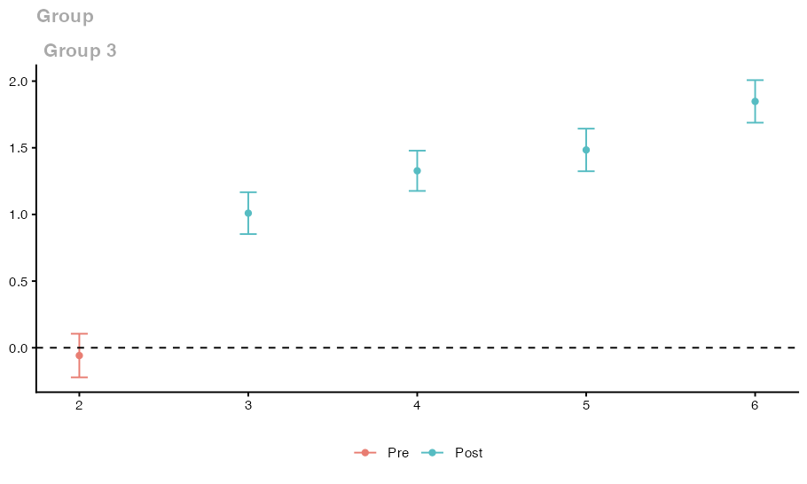
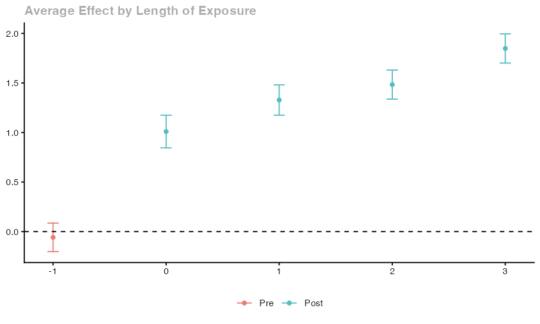

# Get started: estimate effects in a balanced panel

Results below were produced on October 29, 2026 with `cdid` 1.1.0.0, `did` 2.5.1 and `DRDID` 1.3.0 under R 4.5.2, using the displayed seeds where applicable. These are individual examples; they do not establish repeated-sample coverage.

This article simulates a small panel in which every unit is observed at every date, estimates the treatment effects in chained mode and then uses each main results function: `print()`, `summary()`, `tidy()`, `glance()`, the four types of `aggte()`, `ggdid()` and export to files. Panels with missing outcomes come later in the guide.


## The question

About half of 2000 units start a treatment in period 3 and stay treated. What is the average effect of the treatment on these units in each of periods 3 to 6, and how do the effects summarize?

## Prepare the panel

The simulation uses base R only. All objects are created here.

```r
set.seed(20261024)

n_units <- 2000
n_periods <- 6

# Each unit is either never treated (coded 0) or first treated in period 3.
# Cohort membership and the fixed individual effect are drawn independently.
first_treat <- sample(c(0, 3), size = n_units, replace = TRUE)
unit_effect <- rnorm(n_units)

sim_panel <- data.frame(
  id = rep(seq_len(n_units), each = n_periods),
  period = rep(seq_len(n_periods), times = n_units),
  first_treat = rep(first_treat, each = n_periods)
)

# True effect: 1 + 0.25 * (period - first_treat) once treated, zero before.
treated_now <- sim_panel$first_treat > 0 &
  sim_panel$period >= sim_panel$first_treat
sim_panel$true_effect <- ifelse(
  treated_now,
  1 + 0.25 * (sim_panel$period - sim_panel$first_treat),
  0
)

# Outcome: fixed individual effect, a trend shared by all units,
# the treatment effect and independent normal noise.
sim_panel$y <- rep(unit_effect, each = n_periods) +
  0.5 * sim_panel$period +
  sim_panel$true_effect +
  rnorm(nrow(sim_panel))

head(sim_panel)
table(first_treat)
stopifnot(all(table(sim_panel$id) == n_periods))
```

Output:

```text
id period first_treat true_effect         y
1  1      1           0           0 0.8292915
2  1      2           0           0 0.2361102
3  1      3           0           0 0.2348822
4  1      4           0           0 1.2642344
5  1      5           0           0 1.2470521
6  1      6           0           0 4.4757543
first_treat
   0    3 
 990 1010
```
`sim_panel` is one data frame with one row per unit and period, 12000 rows in total. The last line checks that every unit appears in all six periods.

| Column | Meaning | Argument |
| --- | --- | --- |
| `y` | outcome | `yname` |
| `period` | date, 1 to 6 | `tname` |
| `id` | unit identifier | `idname` |
| `first_treat` | first treatment period, 0 for units never treated | `gname` |
| `true_effect` | simulated effect, kept only for checking | not used |

The study population is the 2000 simulated units. Because every unit is observed at every date, the units in `sim_panel` define it and no unit table (`frame`) is needed.

The simulated truth follows directly from the design. The effect is the same for every treated unit, so each average effect equals the effect in the formula.

| Quantity | Simulated truth |
| --- | --- |
| Cohort 3, period 2 compared with period 1 (before treatment) | 0 |
| ATT(3,3) | 1.00 |
| ATT(3,4) | 1.25 |
| ATT(3,5) | 1.50 |
| ATT(3,6) | 1.75 |
| Average over periods 3 to 6 | 1.375 |

## Assumptions for this example

- **Comparison group.** Units never treated (`control_group = "nevertreated"`).
- **No anticipation.** Units do not react before period 3 (`anticipation = 0`). The reference period of cohort 3 is therefore period 2.
- **Parallel trends from the reference period (PT-post).** Without treatment, the average outcome of cohort 3 would have changed from period 2 to each later period by the same amount as the average outcome of the units never treated. The simulation satisfies this by construction, because the only trend is shared by all units.
- **No covariates and equal weights.** Treatment does not depend on any characteristic, so no covariate adjustment is needed, and every unit has the same weight.
- **Overlap.** Both groups contain many units.

The fixed individual effect differs across units, but it cancels from every change within a unit.

## Estimate the effects

```r
set.seed(1)
fit <- cdid::att_gt(
  yname = "y",
  tname = "period",
  idname = "id",
  gname = "first_treat",
  data = sim_panel,
  control_group = "nevertreated",
  est_method = "ipw",
  mode = "chained",
  pt_assumption = "post"
)
```

Calls are qualified with `cdid::` so that loading `did` later in the session cannot change which function runs. `mode = "chained"` is already the default for panel data; it is written here so that the comparison with `did` at the end of this article is easy to read. `est_method = "ipw"` selects treatment weighting (the package default is `"dr"`). Without covariates, the treatment propensity model contains only an intercept. `pt_assumption = "post"` is the default and is written for clarity.

The inference settings keep their defaults: `bstrap = TRUE`, `cband = TRUE`, `biters = 1000` and `alp = 0.05`. The standard errors therefore come from 1000 multiplier bootstrap draws, and the band is a 95% simultaneous band over the reported cells. The draws use your session's random number stream, so `set.seed(1)` makes them reproducible.

### Settings used

| Argument | Value in this example | Definition |
| --- | --- | --- |
| `yname`, `tname`, `idname`, `gname` | `"y"`, `"period"`, `"id"`, `"first_treat"` | [Data, timing and comparison group](reference/options.md#data-timing-and-comparison-group) |
| `control_group` | `"nevertreated"` | [Data, timing and comparison group](reference/options.md#data-timing-and-comparison-group) |
| `est_method` | `"ipw"` | [Treatment adjustment](reference/options.md#treatment-adjustment) |
| `mode` | `"chained"` | [Chained arguments](reference/options.md#chained-arguments) |
| `pt_assumption` | `"post"` | [Parallel trends and reporting](reference/options.md#parallel-trends-and-reporting) |
| `bstrap`, `cband`, `biters`, `alp` | defaults | [Inference and computation](reference/options.md#inference-and-computation) |

The result records these choices: `fit$DIDparams` holds the familiar `did` settings (for example `fit$DIDparams$est_method` and `fit$DIDparams$control_group`), `fit$chained$pt` holds the parallel trends choice and `fit$chained$inference` describes the uncertainty calculation that was actually performed.

## Read the result

```r
summary(fit)
```

<details>
<summary>Console output</summary>

```text
cdid chained difference-in-differences (chained IPW-GMM): cdid_MP
  cdid 1.1.0.0 result built on did 2.5.1 (tested: did 2.5.1); did's MP methods tabulate the estimates below.
  Chained estimators: Bellego C., Benatia D. and V. Dortet-Bernadet (2025). "The Chained Difference-in-Differences." Journal of Econometrics 248, 105783. doi:10.1016/j.jeconom.2024.105783.
  Ordinary estimators: Callaway B. and P. H. C. Sant'Anna (2021). "Difference-in-Differences with Multiple Time Periods." Journal of Econometrics 225(2), 200-230. doi:10.1016/j.jeconom.2020.12.001.

Call:
cdid::att_gt(yname = "y", tname = "period", idname = "id", gname = "first_treat", 
    data = sim_panel, control_group = "nevertreated", est_method = "ipw", 
    mode = "chained", pt_assumption = "post")

Group-Time Average Treatment Effects:
 Group Time ATT(g,t) Std. Error [95% Simult.  Conf. Band]  
     3    2  -0.0583     0.0644       -0.2217      0.1051  
     3    3   1.0096     0.0619        0.8527      1.1666 *
     3    4   1.3274     0.0596        1.1763      1.4785 *
     3    5   1.4837     0.0630        1.3239      1.6436 *
     3    6   1.8478     0.0629        1.6882      2.0074 *
---
Signif. codes: `*' confidence band does not cover 0

P-value for pre-test of parallel trends assumption:  0.359889309273502
Control Group:  Never Treated,  Anticipation Periods:  0
Estimation Method:  Inverse Probability Weighting

Chained support: 5 of 5 requested cells available.
  Units: 2000 in the unit table, 2000 observed at all 6 dates, 2000 with at least two observed outcomes.
  Observation correction: none (selection = "none").
  Parallel trends: PT-post; base_period = "varying".
  GMM weighting: optimal (two-step); covariance regularization: not applied (moment covariance well conditioned).
  Inference: multiplier-bootstrap IQR standard errors (1000 draws), unit-level; simultaneous band over the available cells.
  Parallel-trends pre-test: W = 0.838279, df = 1, p = 0.3599 (Wald test of the pretrend cell).
```

</details>

Typing `fit` gives the same display as `summary(fit)`. It has three parts.

1. A heading line names the chained estimator.
2. The `did` summary follows: the call, the table of group time effects with standard errors and confidence limits, the p value of the pretrend test when that test is available, and the comparison group, anticipation and estimation method.
3. A short chained record closes the display: how many requested cells are available and why any are unavailable; the units of the unit table, how many are observed at every date and how many have at least two observed outcomes; the correction for missing outcomes; the parallel trends assumption and `base_period`; the GMM weighting and whether covariance regularization was applied; the inference actually performed; and the pretrend test, or the reason it is unavailable.

The heading gives the package versions and both paper references once, followed by the call and results. Detailed technical records remain accessible in the result, for example in `fit$chained$references`, `fit$chained$versions` and `fit$chained$covariance_handling`.

With the default `base_period = "varying"`, the table for cohort 3 should contain one comparison before treatment (period 2 relative to period 1) and four effects after treatment (periods 3 to 6, each relative to period 2). When you run the code, compare the estimates with the simulated truth above. With 2000 units the estimates will not equal the truth exactly, and a 95% band can miss in a particular draw. Every requested cell should be reported as available, and the pretrend test should cover the single comparison before treatment. A test that does not reject is consistent with parallel trends but does not establish them.

### Tables of cells and fit summary

```r
cells <- cdid::tidy(fit)
cells[, c("target.id", "role", "estimate", "std.error",
          "conf.low", "conf.high", "available")]

cdid::glance(fit)
```

Output:

```text
target.id role    estimate  std.error   conf.low conf.high available
1 pre(g=3,t=2)  pre -0.05831968 0.06442666 -0.2217344 0.1050951      TRUE
2 ATT(g=3,t=3) post  1.00962257 0.06188506  0.8526545 1.1665907      TRUE
3 ATT(g=3,t=4) post  1.32743963 0.05956931  1.1763453 1.4785340      TRUE
4 ATT(g=3,t=5) post  1.48374276 0.06300654  1.3239301 1.6435554      TRUE
5 ATT(g=3,t=6) post  1.84780436 0.06292532  1.6881977 2.0074110      TRUE
  nobs ngroup ntime control.group est.method       estimator n.requested n.available
1 2000      1     6  nevertreated        ipw chained IPW-GMM           5           5
                                       band.family                   inference clustered
1 simultaneous_multiplier_sup_t_over_supported_ids multiplier_bootstrap_iqr_se     FALSE
```
`tidy()` returns one row per reported cell. It retains `did`'s columns, including `estimate`, `std.error` and the interval limits `conf.low` and `conf.high`, updates `statistic` and `p.value` from the chained inference record, and adds `target.id`, `role` (`"pre"`, `"post"` or `"reference"`), `available`, `support.status`, `support.reason`, `certified` and `band.family`. The p-values are pointwise even when the interval limits use a simultaneous critical value. `glance()` returns one row that adds `estimator`, `n.requested`, `n.available`, `band.family`, `inference` and `clustered` to the columns of `did`'s method. The [results reference](reference/results.md#tables-from-tidy-and-glance) defines every added column.

In the run described at the top of this article, all five requested cells were reported as available. This table compares them with the simulated truth, rounded to three decimals:

| `target.id` | Simulated truth | `estimate` | Bootstrap `std.error` | 95% simultaneous band (`conf.low` to `conf.high`) |
| --- | --- | --- | --- | --- |
| `pre(g=3,t=2)` | 0 | -0.058 | 0.064 | -0.222 to 0.105 |
| `ATT(g=3,t=3)` | 1.00 | 1.010 | 0.062 | 0.853 to 1.167 |
| `ATT(g=3,t=4)` | 1.25 | 1.327 | 0.060 | 1.176 to 1.479 |
| `ATT(g=3,t=5)` | 1.50 | 1.484 | 0.063 | 1.324 to 1.644 |
| `ATT(g=3,t=6)` | 1.75 | 1.848 | 0.063 | 1.688 to 2.007 |

The band uses one critical value for all five cells, so each of its intervals is wider than the pointwise interval in `point.conf.low` and `point.conf.high`. In this draw every band interval contains the simulated truth. That describes one draw; it is not evidence that the band attains its nominal 95% coverage.

## Aggregate the effects

```r
set.seed(2)
agg_simple <- cdid::aggte(fit, type = "simple")
agg_group <- cdid::aggte(fit, type = "group")
agg_dynamic <- cdid::aggte(fit, type = "dynamic")
agg_calendar <- cdid::aggte(fit, type = "calendar")

summary(agg_dynamic)
```

<details>
<summary>Console output</summary>

```text
cdid chained difference-in-differences (chained IPW-GMM): cdid_AGGTEobj
  cdid 1.1.0.0 result built on did 2.5.1 (tested: did 2.5.1); did's AGGTEobj methods tabulate the estimates below.
  Chained estimators: Bellego C., Benatia D. and V. Dortet-Bernadet (2025). "The Chained Difference-in-Differences." Journal of Econometrics 248, 105783. doi:10.1016/j.jeconom.2024.105783.
  Ordinary estimators: Callaway B. and P. H. C. Sant'Anna (2021). "Difference-in-Differences with Multiple Time Periods." Journal of Econometrics 225(2), 200-230. doi:10.1016/j.jeconom.2020.12.001.

Call:
cdid::aggte(fit, type = "dynamic")

Overall summary of ATT's based on event-study/dynamic aggregation:  
    ATT    Std. Error     [ 95%  Conf. Int.]  
 1.4172        0.0486     1.3218      1.5125 *


Dynamic Effects:
 Event time Estimate Std. Error [95% Simult.  Conf. Band]  
         -1  -0.0583     0.0586       -0.2026      0.0860  
          0   1.0096     0.0669        0.8450      1.1743 *
          1   1.3274     0.0622        1.1744      1.4804 *
          2   1.4837     0.0596        1.3371      1.6304 *
          3   1.8478     0.0598        1.7005      1.9951 *
---
Signif. codes: `*' confidence band does not cover 0

Control Group:  Never Treated,  Anticipation Periods:  0
Estimation Method:  Inverse Probability Weighting

Chained dynamic aggregation: 5 of 5 intended aggregate(s) available; na.rm = FALSE.
  Overall summary: available over its 4 intended bins; pointwise interval.
  Parallel trends: PT-post; base_period = "varying".
  Inference: multiplier-bootstrap IQR standard errors (1000 draws), unit-level; simultaneous band over the available estimates.
```

</details>
`aggte()` works from the stored chained result and does not refit the estimator. Its inference arguments default to `NULL`, which inherits `bstrap`, `cband`, `biters`, `alp` and `clustervars` from `fit`. The aggregates use new multiplier draws from the session's random number stream; setting the seed once before the four calls reproduces them when the calls run in the same order.

| Type | Separate estimates | Overall summary | Simulated truth |
| --- | --- | --- | --- |
| `"simple"` | none | average of all effects after treatment, weighted by cohort shares | 1.375 |
| `"group"` | one per cohort: the average of its effects after treatment | average of the cohort estimates, weighted by cohort shares | 1.375 for cohort 3 and overall |
| `"dynamic"` | one per event time `e = t - g`, here from `-1` to `3` | average of the estimates for event times 0 and later | 0 at `e = -1`, then 1, 1.25, 1.5, 1.75; overall 1.375 |
| `"calendar"` | one per calendar period after treatment starts, here 3 to 6 | average of the calendar period estimates | 1, 1.25, 1.5, 1.75; overall 1.375 |

With a single treated cohort, the four overall summaries share the same truth. With several cohorts they answer different questions, as the [results reference](reference/results.md#four-aggregation-types) explains.

The overall summary of each type is stored in `overall.att` and `overall.se`. This table collects them:

```r
aggregates <- list(
  simple = agg_simple,
  group = agg_group,
  dynamic = agg_dynamic,
  calendar = agg_calendar
)

overall <- data.frame(
  type = names(aggregates),
  estimate = vapply(aggregates, function(a) a$overall.att, numeric(1)),
  std.error = vapply(aggregates, function(a) a$overall.se, numeric(1))
)
overall

agg_tables <- lapply(aggregates, cdid::tidy)
agg_tables$dynamic
cdid::glance(agg_dynamic)
```

<details>
<summary>Console output</summary>

```text
type estimate  std.error
simple     simple 1.417152 0.04910689
group       group 1.417152 0.05076659
dynamic   dynamic 1.417152 0.04863678
calendar calendar 1.417152 0.05154004
     type    term event.time    estimate  std.error  statistic       p.value   conf.low  conf.high
1 dynamic ATT(-1)         -1 -0.05831968 0.05862304 -0.9948252  3.198213e-01 -0.2026070 0.08596765
2 dynamic  ATT(0)          0  1.00962257 0.06688741 15.0943593  1.763929e-51  0.8449944 1.17425077
3 dynamic  ATT(1)          1  1.32743963 0.06216002 21.3552000 3.488752e-101  1.1744468 1.48043243
4 dynamic  ATT(2)          2  1.48374276 0.05959328 24.8978196 7.855929e-137  1.3370674 1.63041813
5 dynamic  ATT(3)          3  1.84780436 0.05983890 30.8796509 2.241017e-209  1.7005245 1.99508426
  point.conf.low point.conf.high    label available restricted n.intended n.used excluded.ids
1     -0.1732187      0.05657937 event_-1      TRUE      FALSE          1      1             
2      0.8785257      1.14071948  event_0      TRUE      FALSE          1      1             
3      1.2056082      1.44927103  event_1      TRUE      FALSE          1      1             
4      1.3669421      1.60054345  event_2      TRUE      FALSE          1      1             
5      1.7305223      1.96508645  event_3      TRUE      FALSE          1      1             
           reason certified                                      band.family
1 intended_target        NA simultaneous_multiplier_sup_t_over_supported_ids
2 intended_target        NA simultaneous_multiplier_sup_t_over_supported_ids
3 intended_target        NA simultaneous_multiplier_sup_t_over_supported_ids
4 intended_target        NA simultaneous_multiplier_sup_t_over_supported_ids
5 intended_target        NA simultaneous_multiplier_sup_t_over_supported_ids
     type nobs ngroup ntime control.group est.method       estimator    status na.rm n.bins
1 dynamic 2000      1     6  nevertreated        ipw chained IPW-GMM available FALSE      5
  n.bins.available overall.status                                      band.family
1                5      available simultaneous_multiplier_sup_t_over_supported_ids
                    inference
1 multiplier_bootstrap_iqr_se
```

</details>
The tidy table of the group type begins with a row for the overall summary (with `label` equal to `"overall"`), followed by one row per cohort. The simple type has one row. The dynamic and calendar tables contain only their separate estimates, so the `overall` table above is the place to find their overall summaries.

## Plot the effects

```r
p_cells <- cdid::ggdid(fit)
p_dynamic <- cdid::ggdid(agg_dynamic)
p_group <- cdid::ggdid(agg_group)
p_calendar <- cdid::ggdid(agg_calendar)

p_cells
p_dynamic
```





`ggdid()` uses `did`'s plots and returns `ggplot2` objects, which you can modify with the usual `ggplot2` functions. The intervals use the same critical values as the tables. As in `did`, the simple type has no plot. Each plot also carries a small table of the plotted points and their status, `attr(p_cells, "cdid_presentation_grid")` for the cell plot and `attr(p_dynamic, "cdid_presentation_bins")` for an aggregate plot, so you can see which points are available.

## Export tables, plots and fitted objects

```r
out_dir <- file.path(tempdir(), "cdid_get_started")
dir.create(out_dir, showWarnings = FALSE)

write.csv(cells, file.path(out_dir, "att_gt_cells.csv"), row.names = FALSE)
for (type in names(agg_tables)) {
  write.csv(agg_tables[[type]],
            file.path(out_dir, paste0("aggte_", type, ".csv")),
            row.names = FALSE)
}
write.csv(overall, file.path(out_dir, "overall_summaries.csv"), row.names = FALSE)

ggplot2::ggsave(file.path(out_dir, "event_study.pdf"), p_dynamic,
                width = 7, height = 4)

saveRDS(fit, file.path(out_dir, "att_gt_fit.rds"))
saveRDS(agg_dynamic, file.path(out_dir, "aggte_dynamic.rds"))
```

The tidy tables are ordinary data frames, so `write.csv()` exports them with unavailable values written as `NA`. Saved result objects can be reloaded with `readRDS()` in a session that uses the same package versions. A chained result does not contain the panel data, so keep the data and the code that produced the fit alongside it.

## Optional: compare with did

The following call matches the chained fit except for `mode`. `pt_assumption` is left out because `did` has no such argument; ordinary mode would ignore it in any case.

```r
fit_did <- cdid::att_gt(
  yname = "y",
  tname = "period",
  idname = "id",
  gname = "first_treat",
  data = sim_panel,
  control_group = "nevertreated",
  est_method = "ipw",
  mode = "ordinary"
)

comparison <- merge(
  data.frame(group = fit$group, time = fit$t, chained = fit$att),
  data.frame(group = fit_did$group, time = fit_did$t, ordinary = fit_did$att),
  by = c("group", "time")
)
comparison$difference <- comparison$chained - comparison$ordinary
comparison
```

Output:

```text
group time     chained    ordinary    difference
1     3    2 -0.05831968 -0.05831968 -5.995204e-15
2     3    3  1.00962257  1.00962257 -1.776357e-15
3     3    4  1.32743963  1.32743963  1.376677e-14
4     3    5  1.48374276  1.48374276 -5.018208e-14
5     3    6  1.84780436  1.84780436  5.107026e-15
```
Ordinary mode passes the call to `did::att_gt()` and returns `did`'s own result object.

**What to expect.** This design meets the conditions of a known algebraic reduction: a complete panel, units never treated as controls, no covariates, the same weight for each unit in every comparison, PT-post, and the same anticipation and `base_period` in both calls. Under these conditions each chained comparison is the difference between the mean change of cohort 3 and the mean change of the units never treated between its two dates, and the changes over consecutive dates add up to the change over the whole span. The chained combination therefore reduces to the long comparisons that `did` computes, and the `difference` column is expected to be zero up to floating point rounding.

That expectation comes from the algebra of this common case. In the run described at the top of this article, the largest absolute value in the `difference` column over the five cells was 5.02e-14, consistent with floating point rounding. Standard errors and bands are a separate comparison, and this article makes no claim about them. Outside this reduction, differences require an actual difference in the fitted specification/procedure, the retained moment system or the analysis sample. Covariates alone, or the OR/DR label alone, are not an explanation. Fixed-horizon NYT reuse and the additional PT-all restrictions are distinct reasons, as the migration page explains. [Moving from did](from-did.md#when-chained-and-did-estimates-should-agree) explains each case.

## Next steps

- [Moving from did](from-did.md) for the differences between the two modes.
- [Handling missing outcomes](methods/missing-outcomes.md) for panels with missing outcomes.
- [Results reference](reference/results.md) for every field and the uncertainty rules.

---

**Reading path, step 1 of 20** · Previous: [Guide home](README.md) · Next: [Moving from did](from-did.md)

<details>
<summary>All steps of the reading path</summary>

| Step | Page |
| --- | --- |
| 1 | **Get started** (this page) |
| 2 | [Moving from did](from-did.md) |
| 3 | [Incomplete panels](examples/incomplete-panels.md) |
| 4 | [Identify effects when the observed units change composition](examples/identification.md) |
| 5 | [How to compare precision](examples/precision.md) |
| 6 | [Prepare your panel and unit table](help/prepare-data.md) |
| 7 | [Treatment adjustment](methods/treatment.md) |
| 8 | [Choose IPW, OR or DR in an incomplete panel](examples/treatment-choice.md) |
| 9 | [Handling missing outcomes](methods/missing-outcomes.md) |
| 10 | [Sampling information for the observation model](methods/sampling-information.md) |
| 11 | [Choose an observation model](examples/observation-models.md) |
| 12 | [Impute actual changes](examples/change-imputation.md) |
| 13 | [Parallel trends](methods/parallel-trends.md) |
| 14 | [Add PT-all restrictions](examples/pt-all-comparison.md) |
| 15 | [GMM weighting and covariance regularization](methods/gmm.md) |
| 16 | [Robustness](examples/robustness.md) |
| 17 | [Inference](examples/inference.md) |
| 18 | [Options](reference/options.md) |
| 19 | [Results](reference/results.md) |
| 20 | [Diagnose errors and unavailable results](help/troubleshooting.md) |

[Guide home](README.md) · [Package overview](../README.md)

</details>
