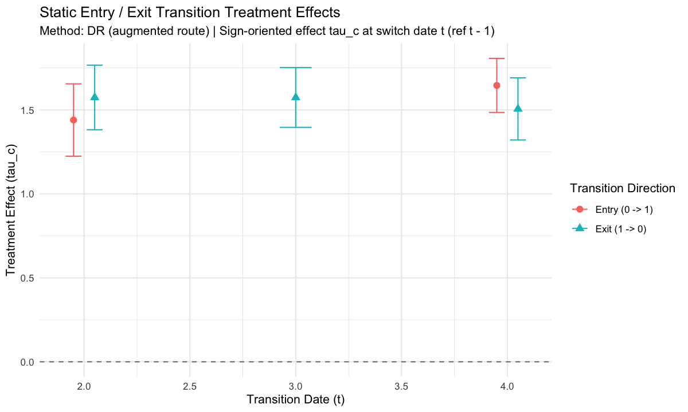

# When treatment can stop and restart

A unit may enter treatment, leave it and be treated again. A single first-treatment date cannot describe that history. In `cdid` 1.3.0.0, supply the binary treatment indicator through `dname` to estimate effects at those changes in treatment status.

This is a **static model without carryover**: earlier treatment must have no lingering effect beyond current treatment status. Effects may differ across units and dates. If an earlier treatment episode continues to affect the outcome after it ends, this route does not identify the intended static effects under its maintained assumptions.

## First treatment date or current treatment status?

| | `gname` | `dname` |
| --- | --- | --- |
| Typical history | `0 0 1 1 1` | `0 1 1 0 1` |
| Input column | First treatment date for each unit; `0` if never treated | Binary treatment status at each date |
| Question | What is the effect at date `t` for the cohort first treated at `g`? | What is the effect at a switching date for the units entering or leaving treatment? |
| Past treatment | Effects may evolve with time since adoption | No lingering effect of past treatment beyond current status |
| Aggregate | `aggte(fit, ...)`, including event-study summaries | `fit$aggregate`, a switcher-weighted average |

Use `gname` for permanent adoption and cohort effects over time. Use `dname` for switching-date effects under the static assumption. Absorbing data can also be supplied through `dname`, but that still requests the static model and its targets. Treatment being absorbing does not imply that earlier exposure has no lingering effect. In chained panel mode, the package uses the argument you supply; supplying both is an error. Explicit `mode = "ordinary"` delegates to `did` and ignores the static arguments.

Entrants are compared with units that remain untreated at that transition. Exiters are compared with units that remain treated. Each comparison needs the corresponding conditional parallel-trends assumption. An exit estimate is reported as the effect of treatment, `Y(1) - Y(0)`, for the units leaving treatment; the raw exit contrast is sign-reversed. Positive entry and exit estimates can therefore both describe a beneficial treatment.

## What your input needs

Supply long data with unit ID, date, binary treatment and outcome columns. Keep a row for each unit and study date, including dates where the outcome is `NA`:

- Treatment must be known at every study date. Missing treatment values or absent unit-date rows are refused; they are never interpreted as untreated.
- The required covariates must be available at each transition's reference date, the preceding stored panel date. Observation and outcome models may use different formulas.
- Outcomes may be missing in consecutive or intermittent patterns. Observed outcome changes need to connect the reference and switching dates for both switchers and their stayers, under the assumptions below.

Units with zero or one observed outcome contribute no observed change. They remain in the study population and the relevant role counts, observation-model fits, imputed-change evaluations and full-unit inference. They are not additional observed pairs.

## A runnable example

The example keeps treatment and `x` known, then makes some outcomes missing with a probability depending on `x`. The conditional augmented fit addresses that dependence. The no-equation fit is a comparator: this data-generating process does not establish its stronger baseline missingness assumption.

```r
library(cdid)
set.seed(20261106)

n_units <- 400
n_dates <- 4

unit_id <- seq_len(n_units)
x_unit <- rnorm(n_units)
alpha_unit <- rnorm(n_units, sd = 0.5)

# Assign 5 binary treatment paths, including stayers in both treatment states
d_paths <- rbind(
  c(0L, 0L, 0L, 0L), # never treated stayer
  c(0L, 1L, 1L, 0L), # entry at t=2, stayer at t=3, exit at t=4
  c(1L, 1L, 0L, 1L), # stayer at t=2, exit at t=3, re-entry at t=4
  c(1L, 0L, 0L, 1L), # exit at t=2, stayer at t=3, re-entry at t=4
  c(1L, 1L, 1L, 1L)  # treated stayer, including at t=4
)
path_id <- sample.int(nrow(d_paths), size = n_units, replace = TRUE)

panel_static <- data.frame(
  id = rep(unit_id, each = n_dates),
  time = rep(seq_len(n_dates), times = n_units),
  x = rep(x_unit, each = n_dates),
  d = as.integer(t(d_paths[path_id, ]))
)

# Static no-carryover outcome Y_{it}(d_t) with true effect tau = 1.5 * d_{it}
y_latent <- rep(alpha_unit, each = n_dates) +
  (0.3 + 0.2 * panel_static$x) * panel_static$time +
  1.5 * panel_static$d +
  rnorm(nrow(panel_static), sd = 0.4)

# Missing outcomes depending on x (complete binary d and x are retained on all rows)
obs_prob <- plogis(0.8 + 0.4 * panel_static$x)
panel_static$y <- ifelse(runif(nrow(panel_static)) < obs_prob, y_latent, NA_real_)

# 1. Baseline comparator (no observation-probability or imputation equation)
# Observation depends on x here, so the baseline sufficient assumption is not
# established by this DGP. The conditional correction below addresses that dependence.
fit_base <- cdid::att_gt(
  yname = "y", tname = "time", idname = "id", dname = "d",
  xformla = ~ x, data = panel_static,
  est_method = "dr", selection = "none",
  bstrap = FALSE, cband = FALSE
)
summary(fit_base)
cdid::tidy(fit_base)
cdid::glance(fit_base)
fit_base$aggregate
fit_base$references

# 2. Conditional-MTAR augmented correction with treatment DR, IPW, or OR
fit_aug_dr <- cdid::att_gt(
  yname = "y", tname = "time", idname = "id", dname = "d",
  xformla = ~ x, data = panel_static,
  est_method = "dr",
  selection = "conditional_mtar",
  selection_est_method = "dr",
  selection_model = "pair_logit",
  selection_pooling = "within_group",
  imputation_pooling = "within_group",
  imputation_scale = "per_period",
  outcome_pooling = "separate",
  switchers = "both",
  bstrap = FALSE, cband = FALSE
)
summary(fit_aug_dr)
```

The code above was run with `cdid` 1.3.0.0, R 4.5.2, `did` 2.5.1 and `DRDID` 1.4.0, using the stated seed. The augmented fit returns the following rounded results. These are one simulated dataset, not a coverage study.

| Date | Direction | Estimate | Standard error | 95% lower | 95% upper |
| --- | --- | ---: | ---: | ---: | ---: |
| 2 | entry | 1.4398 | 0.1099 | 1.2244 | 1.6552 |
| 2 | exit | 1.5741 | 0.0982 | 1.3817 | 1.7665 |
| 3 | exit | 1.5739 | 0.0908 | 1.3959 | 1.7518 |
| 4 | entry | 1.6457 | 0.0821 | 1.4847 | 1.8067 |
| 4 | exit | 1.5060 | 0.0943 | 1.3211 | 1.6908 |

The switcher-weighted estimate is **1.5620**, with standard error **0.0454** and 95% interval **[1.4730, 1.6510]**.


```r
cdid::ggdid(fit_aug_dr)
```



## Read the result

`tidy(fit_aug_dr)` gives one row per requested entry or exit date, with the estimate, standard error and availability information. `summary(fit_aug_dr)` displays these effects and their references. The switcher-weighted average is `fit_aug_dr$aggregate`; use that field rather than `aggte()`, whose targets are cohort effects.

With the default `switchers = "both"`, the fit includes entry and exit cells with switchers in the study population. Use `switchers = "entry"` or `"exit"` to choose a direction. An explicit `switch_times` retains the requested cells even when they cannot be estimated. An unavailable effect is reported as `NA` with a reason, never silently removed. If any declared cell is unavailable, the declared aggregate is unavailable too, rather than reweighted over the remaining cells.

## Choose the two adjustments separately

`est_method` selects treatment IPW (`"ipw"`), outcome regression (`"reg"`) or treatment DR (`"dr"`). This choice makes switchers comparable with stayers. It is separate from how missing outcomes are handled:

| Missing-outcome approach | Arguments | What it adds |
| --- | --- | --- |
| No observation equation | `selection = "none"` | Normalized observed-pair changes, under the baseline representativeness assumptions |
| Observation weighting | `selection = "conditional_mtar"`, `selection_est_method = "ipw"` | A model for the probability of observing both outcomes |
| Change imputation | `selection = "conditional_mtar"`, `selection_est_method = "imputation"` | A regression predicting actual outcome changes |
| Augmented correction | `selection = "conditional_mtar"`, `selection_est_method = "dr"` | Observation weighting combined with change imputation |

All three treatment methods support these four missing-outcome approaches. The two meanings of DR remain distinct: augmenting missing-outcome correction does not make treatment IPW or OR doubly robust at the treatment layer.

For observation probabilities, `pair_logit` models the joint event directly. `independent_period_logit` multiplies the two date probabilities and needs the additional conditional-independence assumption. Pooling slopes is a separate modeling choice. `selection_pooling` and `imputation_pooling` accept `"separate"`, `"within_group"` or `"pooled"`; `outcome_pooling` controls the stayer outcome regressions. The [options reference](../reference/options.md) and details below give the precise meanings.

## How chaining handles the gaps

For each transition, `cdid` fixes the switcher and stayer populations before examining observed outcomes. Within each population it uses all date pairs with observed changes. Different units can connect different dates: a unit need not have outcomes at both dates of the final transition if other valid comparisons connect those dates.

For an entry at date 3, the following population values illustrate the calculation. These are analytical values, not output from the simulated example:

| Fixed population for the date-3 transition | Mean change, 1 to 2 | Mean change, 1 to 3 | Recovered change, 2 to 3 |
| --- | ---: | ---: | ---: |
| Switchers | 2 | 5 | `5 - 2 = 3` |
| Stayers | 1 | 2 | `2 - 1 = 1` |

The entry contrast is `3 - 1 = 2`. Earlier changes differ between the two populations, but each cancels within its own chain. This identity does not require parallel trends before the reference date. The observed comparisons must still represent the same fixed populations, with the required missingness adjustment, and the transition needs its maintained parallel-trends assumption.

The package combines those comparisons by GMM when outcomes are missing or a `selection = "conditional_mtar"` adjustment is requested, retaining all supported pairs and connected components. On a complete panel (`all(O == 1)`) with `selection = "none"`, all-pair chaining reduces algebraically to the adjacent change between `t - 1` and `t`, so `att_gt(dname = ...)` runs the direct complete-data baseline kernel without executing all-pair GMM. Graph connectivity checks whether the dates can be connected; it does not establish parallel trends, validate a missingness model or guarantee a successful nuisance fit. Those checks and assumptions remain separate. A disconnected switcher or stayer graph gives an unavailable target with a specific reason.

## Assumptions behind the missing-outcome choices

Without a missing-outcome equation, a sufficient condition is that, within each fixed switcher or stayer population, pair observation does not change the reference-covariate composition and observed pairs are representative of conditional mean outcome changes. These are restrictions on population expectations, not equality of realized sample means. Without covariates, the condition reduces to representativeness of mean changes.

Conditional correction permits observation to depend on covariates, subject to the relevant conditional mean-representativeness, overlap and model conditions. Observation weighting needs a valid probability model; imputation needs a valid actual-change model; the augmented route can use either valid arm. Treatment adjustment has its own conditions. Shared coefficients must be valid throughout their pooling blocks. All active fitted models must satisfy the package's numerical and support requirements, even when a robustness argument permits one model to be misspecified.

Inference uses full original-unit contributions, including estimated nuisance models and random aggregation shares. Clustered inference requires many independent clusters; no finite-sample coverage guarantee is implied. The precise clipping, graph, pooling and inference rules follow below.

<details>
<summary>Mathematical definitions and detailed option behavior</summary>

## Routing: `dname` versus `gname`

In chained panel mode, `att_gt()` chooses between the cohort and static transition routes from the treatment column argument you supply. Explicit `mode = "ordinary"` delegates to `did` before evaluating static arguments:

| Argument supplied | Route selected | Returned class | Aggregation |
| --- | --- | --- | --- |
| `gname` (`dname = NULL`, default) | Absorbing cohort `ATT(g, t)` (staggered adoption) | `cdid_MP` (or `did`'s `MP` in ordinary mode) | `cdid::aggte()` |
| `dname` (`gname` omitted) | Static no-carryover entry, exit and re-entry transitions | `cdid_static_att_gt` | Stored in `fit$aggregate` (`aggte()` refuses `cdid_static_att_gt`) |

- **In chained panel mode, `dname` always selects the static route**, even if the binary column in `data` happens to be an absorbing staggered adoption indicator.
- **`gname` retains the cohort route** unchanged.
- In chained panel mode, specifying both `gname` and `dname` is refused before data inspection.
- The static `dname` route runs in chained panel mode (`panel = TRUE`, `mode = NULL` or `mode = "chained"`, `allow_unbalanced_panel = NULL` or `TRUE`). Cohort-only options (`frame`, `weightsname`, `fix_weights`, `control_group`, non-zero `anticipation`, `base_period = "universal"`, `pt_assumption = "all"`, `pt_start`, `selection_universe != "F"`, `selection_rho`, `selection_justification`, and custom function `est_method` callbacks) are inapplicable and refused with diagnostic errors.

## Causal benchmark: static potential outcomes without carryover

The static `dname` route relies on a **no-carryover (no treatment-history effects)** potential-outcomes benchmark. At every panel date $t \in \{t_1, \dots, t_T\}$, unit $i$'s potential outcome depends only on its current binary treatment status $d_t \in \{0, 1\}$:
$$Y_{it}(d_1, \dots, d_t) = Y_{it}(d_t) \in \{Y_{it}(0), Y_{it}(1)\}.$$

- **Entry, exit and re-entry are permitted:** A unit's observed binary treatment sequence $D_i = (D_{i1}, \dots, D_{iT}) \in \{0, 1\}^T$ may switch from $0$ to $1$ (entry), from $1$ to $0$ (exit), and back again (re-entry) across dates.
- **Lasting dynamic effects from past treatment are excluded:** Past treatment status $D_{i,1:t-1}$ must not directly shift current outcomes $Y_{it}(0)$ or $Y_{it}(1)$. If earlier treatment has lasting dynamic or carryover effects in later periods, units with $D_{i,t-1} = 1$ (or units re-entering after earlier treatment episodes) can experience ongoing treatment-history trends between $t - 1$ and $t$, violating the static identification benchmark.

### Transition cells and sign-oriented treatment effects

Each transition cell $c = (t, d)$ is indexed by a transition date $t \in \{t_2, \dots, t_T\}$ (for $t=t_j$, anchored at the preceding stored date $t_{\text{prev}}=t_{j-1}$; below, $t-1$ denotes that preceding date, not subtraction of one calendar unit) and a prior treatment state $d = D_{i,t-1} \in \{0, 1\}$:

- **Risk set ($R_c$):** Units with prior treatment state $D_{i,t-1} = d$, of size $n_{\text{risk}, c}$.
- **Switchers ($G_c$):** Units that change treatment status at date $t$, $G_c = \{i : D_{i,t-1} = d,\; D_{it} = 1 - d\}$, of size $n_{\text{switchers}, c}$.
  - When $d = 0$, $G_c$ is the **entry** group ($0 \to 1$).
  - When $d = 1$, $G_c$ is the **exit** group ($1 \to 0$).
- **Stayers ($C_c$):** Units with the same prior state $d$ that keep status $d$ at date $t$, $C_c = \{i : D_{i,t-1} = d,\; D_{it} = d\}$, of size $n_{\text{stayers}, c}$. Same-prior-state stayers serve as the control group for cell $c$.

Let $\theta_c$ denote the raw switcher-versus-stayer difference-in-differences contrast between $t - 1$ and $t$:
$$\theta_c = E[Y_{it} - Y_{i,t-1} \mid i \in G_c] - E[Y_{it}(d) - Y_{i,t-1}(d) \mid i \in G_c].$$
Under no carryover ($Y_{is} = Y_{is}(D_{is})$) and conditional parallel trends of status-$d$ potential outcome changes between $t - 1$ and $t$ within $R_c$, multiplying $\theta_c$ by the transition sign $\sigma_c = 1 - 2d \in \{+1, -1\}$ yields the sign-oriented switch-time treatment effect:
$$\tau_c = \sigma_c \theta_c = E[Y_{it}(1) - Y_{it}(0) \mid i \in G_c].$$
For entry cells ($d = 0$, $\sigma_c = +1$), $\theta_c = E[Y_{it}(1) - Y_{it}(0) \mid i \in G_c]$ directly. For exit cells ($d = 1$, $\sigma_c = -1$), switchers move from $Y_{i,t-1}(1)$ to $Y_{it}(0)$ while stayers remain at status $1$, so $\theta_c = -E[Y_{it}(1) - Y_{it}(0) \mid i \in G_c]$ and multiplying by $\sigma_c = -1$ orients $\tau_c$ as the effect of treatment ($1$ versus $0$) on the exiting switchers at date $t$. Both `estimate` (`att`) and `theta.hat` (`theta_hat`) are reported in `cdid_static_att_gt` and `tidy()`.

### Selecting transition directions and dates

Two arguments define the declared target set $A$:

- `switchers`: `"both"` (default, includes both entry $0 \to 1$ and exit $1 \to 0$ transitions), `"entry"` ($d = 0$ only), or `"exit"` ($d = 1$ only).
- `switch_times`: `NULL` (default) or a vector of panel transition dates in $\{t_2, \dots, t_T\}$.
  - When `switch_times = NULL`, `att_gt()` automatically includes every candidate transition cell in the requested direction(s) that has at least one switcher ($n_{\text{switchers}, c} \ge 1$) in the study population.
  - When `switch_times` is supplied explicitly, every requested direction at each requested date is retained in $A$. If an explicitly requested cell has zero switchers ($n_{\text{switchers}, c} = 0$), it is kept in the result with `available = FALSE` and `support_status = "empty_switchers"` rather than silently dropped.

## Panel data, missing outcomes and role-pair graphs

### Complete binary treatment histories and reference covariates

Every study unit $i \in \{1, \dots, n\}$ in `data` must have:

1. **A complete, known binary treatment path** $D_i = (D_{i1}, \dots, D_{iT}) \in \{0, 1\}^T$ across all $T$ panel dates. Missing or absent unit-date treatment indicators are refused (`cdid_static_missing_treatment_error`).
2. **Complete required reference covariates** (`xformla` and, when active, `selection_xformla`). Covariates are unit-constant or read at the transition cell's reference date $t - 1$.

### General missing outcomes and retained zero/single-outcome units

Outcome values $Y_{it}$ may be missing (`NA`) in general patterns across dates (including non-monotone gaps, attrition, and re-entry into observation), provided the active missing-outcome, parallel-trends, overlap, and role-graph connectivity assumptions hold.

Every unit in `data` belongs to the study population of size $n$:

| Unit outcome count | Role in static estimation and inference |
| --- | --- |
| Repeat-outcome units ($\sum_t O_{it} \ge 2$, `n_repeat_outcome_units`) | Supply observed outcome changes $\Delta Y_{i,s,u} = Y_{iu} - Y_{is}$ on pairs $(s, u)$ with $O_{is} O_{iu} = 1$, plus full-population role membership, covariates, and influence-function rows. |
| Single-outcome units ($\sum_t O_{it} = 1$, `n_single_outcome_units`) | Supply no observed pair differences, but are retained in the study population count $n$, role counts (`n_risk`, `n_switchers`, `n_stayers`), active observation-probability fits and evaluation of imputed changes (but no observed-pair regression scores), and the $n$-row original-unit influence functions. |
| Zero-outcome units ($\sum_t O_{it} = 0$, `n_zero_outcome_units`) | Retained in the study population, role counts, active observation-probability fits and evaluation of imputed changes (but no observed-pair regression scores), and the $n$-row original-unit influence functions on the same basis as single-outcome units. |

### All-positive-count role graphs and endpoint connectivity

For each required cell $c = (t, d)$ and role $a \in \{G, C\}$ (switchers $G_c$ and stayers $C_c$), `cdid` inspects all $\binom{T}{2}$ ordered date pairs $(s, u)$ with $s < u$ and retains **every date pair with at least one observed unit in that role** ($n_{\text{observed, role}} \ge 1$). All connected components ($K_c^a \ge 1$), long gaps, earlier bridges, and multiple paths are retained without pruning disconnected components or selecting a single path.

A declared target cell $c = (t, d)$ passes the graph-support check (`support_status = "ok"`) if and only if:

1. $n_{\text{switchers}, c} \ge 1$ (otherwise `support_status = "empty_switchers"`),
2. $n_{\text{stayers}, c} \ge 1$ (otherwise `support_status = "empty_stayers"`),
3. the retained positive-count pair graph for switchers $(c, G)$ connects the baseline date $t - 1$ and the transition date $t$ (otherwise `support_status = "disconnected_switcher_graph"`), and
4. the retained positive-count pair graph for stayers $(c, C)$ connects $t - 1$ and $t$ (otherwise `support_status = "disconnected_stayer_graph"`).

Passing this support check does not replace the checks on active nuisance fits and the numerical system. Those must also succeed before an estimate can be reported.

When multiple paths connect the dates in a role graph ($m_{\text{edges}} - (n_{\text{active dates}} - K_c^a) > 0$), the overidentified within-role pair equations are combined jointly with the transition equations by GMM using `gmm_weighting = "optimal"` (alias `"two_step"`, default, with `gmm_covariance = "tikhonov"` ridge handling when singular or near-singular) or `gmm_weighting = "identity"`.

## Treatment and missing-outcome adjustments

The static route separates the **switch-time treatment adjustment** (`est_method`) from the **missing-outcome adjustment** (`selection` and `selection_est_method`). All built-in combinations are supported:

| `selection` | `selection_est_method` | Route name (`request$route`) | `est_method = "ipw"` | `est_method = "reg"` | `est_method = "dr"` |
| --- | --- | --- | --- | --- | --- |
| `"none"` (default) | `"ipw"` (required) | `"baseline"` | supported | supported | supported |
| `"conditional_mtar"` | `"ipw"` | `"weighting"` | supported | supported | supported |
| `"conditional_mtar"` | `"imputation"` | `"imputation"` | supported | supported | supported |
| `"conditional_mtar"` | `"dr"` | `"augmented"` | supported | supported | supported |

### 1. Baseline / no-equation route (`selection = "none"`)

With `selection = "none"` (which requires `selection_est_method = "ipw"`), no observation-probability logit or actual-change imputation model is fitted. When all outcomes are observed (`all(O == 1)`), `att_gt(dname = ...)` dispatches directly to the native complete-data baseline kernel (`static_complete_fit`) on the adjacent changes $\Delta Y_{i,t-1,t} = Y_{it} - Y_{i,t-1}$ and records `diagnostics$backend_status = "accepted_static_complete_fit_integration"` and `diagnostics$gmm_executed = FALSE`. When outcomes are missing, it uses normalized means of observed pair changes within each fixed switcher or stayer population and combines them by chained GMM (`static_missing_fit`, `diagnostics$backend_status = "accepted_static_missing_fit_integration"`, `diagnostics$gmm_executed = TRUE`), with the active treatment adjustment.

The accepted sufficient baseline assumption has two parts for every retained pair and role population: the pair-observation probability is constant across the reference covariates within that population, and observed pairs are representative of its mean outcome change conditional on those covariates. Thus the observed pairs preserve both the role population's covariate composition and its conditional mean changes. With no covariates, this reduces to representativeness of the mean change. Conditional mean representativeness alone, when observation varies with the covariates, does not establish this baseline route; use an appropriate conditional correction below. These are population restrictions, not equality of realized sample means.

### 2. Conditional-MTAR observation weighting (`selection = "conditional_mtar"`, `selection_est_method = "ipw"`)

When observation on pair $k = (s, u)$ depends on covariates, `selection_est_method = "ipw"` fits an observation-probability model $\hat{q}_{c,a,k}(W_i)$ using `selection_xformla` (which inherits `xformla` when `NULL`) over all units in role $(c, a)$ (including units with zero or one observed outcome) and weights observed pair changes by $1 / \max(\hat{q}_{c,a,k}(W_i), 10^{-6})$:

- `selection_model = "pair_logit"` (default): fits a binary logit directly for the joint event $S_{ik} = O_{is} O_{iu} = 1$ on each active pair $k$ and role $(c, a)$. Observation at $s$ and $u$ may be dependent given $(c, a, W_i)$.
- `selection_model = "independent_period_logit"`: fits binary logits for period observation $O_{it} = 1$ at active dates and forms the pair probability as the product $\hat{q}_{c,a,k}(W_i) = \hat{p}_{c,a,s}(W_i)\hat{p}_{c,a,u}(W_i)$, floored at $10^{-6}$ on the final product. This additionally requires conditional independence of $O_{is}$ and $O_{iu}$ given $(c, a, W_i)$.

### 3. Conditional-MTAR actual-change imputation (`selection = "conditional_mtar"`, `selection_est_method = "imputation"`)

With `selection_est_method = "imputation"`, `cdid` fits a linear weighted least squares (WLS) regression of observed pair changes $\Delta Y_{ik}$ on the `xformla` design among observed units ($S_{ik} = 1$) in role $(c, a)$:
$$\hat{j}_{c,a,k}(X_i) = \hat{\alpha}_{c,a,k} + d_{k}(X_i)'\hat{\beta}_{r(c,a,k)},$$
and evaluates the predicted change $\hat{j}_{c,a,k}(X_i)$ for every unit in the role population $(c, a)$. No observation-probability model is fitted (`selection_model`, `selection_pooling`, and `selection_xformla` are inactive and never evaluated).

`imputation_scale` controls how pair duration enters the imputation covariate design $d_k(X_i)$:

- `imputation_scale = "per_period"` (default): multiplies the non-intercept covariate columns by the panel index gap $L_k = u_{\text{idx}} - s_{\text{idx}}$ between stored calendar positions.
- `imputation_scale = "per_change"`: uses the unscaled covariate columns on each pair change regardless of index gap.

When `imputation_pooling = "separate"`, the two scales are a linear reparameterization of the same pair-specific fit; when slopes are shared across pairs of different index lengths (`"within_group"` or `"pooled"`), they impose different working-model restrictions.

### 4. Conditional-MTAR augmented observation correction (`selection = "conditional_mtar"`, `selection_est_method = "dr"`)

With `selection_est_method = "dr"`, every unit $i$ in role $(c, a)$ on pair $k = (s, u)$ receives the reconstructed pair change
$$\widehat{Z}_{c,a,k,i} = \hat{j}_{c,a,k}(X_i) + \frac{S_{ik}\{\Delta Y_{ik} - \hat{j}_{c,a,k}(X_i)\}}{\max(\hat{q}_{c,a,k}(W_i), 10^{-6})},$$
combining the actual-change WLS imputer $\hat{j}_{c,a,k}(X_i)$ (`imputation_pooling`, `imputation_scale`, `xformla`) with the fitted observation probability $\hat{q}_{c,a,k}(W_i)$ (`selection_model`, `selection_pooling`, `selection_xformla`).

The augmented observation correction works with **all three built-in treatment methods**:

- `est_method = "ipw"`: fits the risk-set treatment propensity logit on $R_c = G_c \cup C_c$ and uses the reconstructed pair changes $\widehat{Z}$ without fitting a counterfactual stayer outcome regression.
- `est_method = "reg"`: fits the counterfactual stayer outcome-change regression to the stayer reconstructions under `outcome_pooling` without fitting a treatment propensity logit.
- `est_method = "dr"`: fits both the risk-set treatment propensity logit and the counterfactual stayer outcome-change regression.

In each case, all active observation, imputation, rate, treatment-propensity, and counterfactual outcome-regression score paths are carried into the $n$-row original-unit influence functions. Every active model must pass its rank, convergence, and interior-root checks; a failed observation logit does not fall back to pure imputation, and a failed imputer does not fall back to observation weighting.

### Probability clipping

Package-owned static inverse-probability weights use the same $10^{-6}$ safeguard as cohort chained mode without trimming units or pairs:

- Risk-set treatment propensities $\hat{p}_c(X_i) = P(i \in G_c \mid i \in R_c, X_i)$ are capped above at $p^{\text{cap}}_c = \min(\hat{p}_c, 1 - 10^{-6})$, bounding control odds $p^{\text{cap}}_c / (1 - p^{\text{cap}}_c)$ by $10^6 - 1$.
- Inverse observation denominators ($\hat{q}_{c,a,k}$ under `"pair_logit"`, the final product $\hat{p}_{c,a,s}\hat{p}_{c,a,u}$ under `"independent_period_logit"`) are floored at $10^{-6}$.
- Raw probabilities enter likelihood scores and information matrices; influence functions differentiate the clipped weights (zeroing direct probability derivatives where a cap or floor binds). The correctly specified observation-probability branch requires its floor to be inactive in population; the correctly specified treatment-propensity branch similarly requires its cap to be inactive. A correct imputation or counterfactual outcome-regression branch can instead establish consistency under the corresponding robustness conditions, even when the other probability branch is misspecified or clipped. Inference still requires the stated regularity conditions. Baseline normalized observed-pair means do not apply an observation-probability floor.

## Slope pooling on the static route

The static route provides independent pooling controls for observation logits (`selection_pooling`), actual-change imputation (`imputation_pooling`), and stayer counterfactual outcome regressions (`outcome_pooling`).

### Observation and imputation pooling (`selection_pooling`, `imputation_pooling`)

Both arguments accept the same three static keywords:

| Value | Meaning on the static `dname` route |
| --- | --- |
| `"separate"` (default) | Separate slope vector for each observation pair (or date) and fixed role population $(c, a)$. |
| `"within_group"` | One shared slope vector across observation pairs (or dates) within each fixed role population $(c, a)$ (a single transition cell $c = (t, d)$ and role $a \in \{G, C\}$). |
| `"pooled"` | One shared slope vector across all active role populations and observation pairs (or dates). |

Every observation pair (or date) and role population retains its own local intercept whenever the formula includes an intercept. Here a "group" is a role population $(c, a)$ indexed by transition date $t$, prior state $d$, and switcher/stayer status $a$, not an absorbing adoption cohort.

### Counterfactual stayer outcome-regression pooling (`outcome_pooling`)

When `est_method` is `"reg"` or `"dr"` (inactive and never evaluated when `est_method = "ipw"`), `outcome_pooling` controls how stayer ($C_c$) counterfactual outcome-change regressions share slopes across transition cells:

| `outcome_pooling` | Meaning on the static `dname` route |
| --- | --- |
| `"separate"` (default) | One stayer slope vector $\beta_c$ and local intercept $\alpha_c$ per transition cell $c \in A$. |
| `"pooled"` | One shared stayer slope vector $\beta$ across all declared transition cells $c \in A$, with cell-specific intercepts $\alpha_c$. |
| Explicit named character vector or named list | Maps each transition `cell_id` (e.g., `"t2_entry"`, `"t3_exit"`) to a block label, or supplies a named list of `cell_id` character vectors defining disjoint regression blocks. May include extra candidate transition cells outside $A$ (`non_target_or_cells`) whose stayers $C_c$ contribute to estimating shared block slopes. Explicit intermediate partitions are supported only on the static `dname` route. |

## Result-owned aggregation, inference and qualifications

### Switcher-frequency aggregate (`fit$aggregate`)

A `cdid_static_att_gt` object stores its own switcher-frequency weighted aggregate across the declared transition set $A$ in `fit$aggregate`:
$$\hat{\delta}_{A,s} = \sum_{c \in A} \hat{\omega}_c \hat{\tau}_c, \qquad \hat{\omega}_c = \frac{n_{\text{switchers}, c}}{\sum_{c' \in A} n_{\text{switchers}, c'}}.$$

- Its $n$-row original-unit influence function (`fit$aggregate$inffunc`) includes both the cell-effect influence functions $\hat{\phi}_{\tau, c}$ and the random switcher-share estimation contribution.
- If any declared cell $c \in A$ is unavailable (`available = FALSE`), `fit$aggregate$available` is `FALSE` and `fit$aggregate$estimate` is `NA_real_`; the aggregate is never silently renormalized over a subset of surviving cells.
- `cdid::aggte()` is designed for cohort `ATT(g, t)` (`MP` / `cdid_MP`) objects and refuses `cdid_static_att_gt` results.

### Inference and references

- **Analytical and multiplier bootstrap inference:** Let $\Psi_i$ be the full original-unit influence-function row, $S_h=\sum_{i\in h}\Psi_i$ the sum in cluster $h$, and $\bar S$ the mean of these cluster sums. The analytical covariance is $\widehat V=n^{-2}\sum_h(S_h-\bar S)(S_h-\bar S)^\prime$, where $n$ counts all study units. Without clustering each unit is its own cluster. `fit$analytical_se` is the square root of the diagonal of `fit$V_analytical`. When `bstrap = TRUE`, `chained_cluster_multiplier()` computes common-sign Rademacher multiplier bootstrap IQR standard errors (`fit$bootstrap_se`) and, when `cband = TRUE` and all declared cells in $A$ are available, a simultaneous sup-$t$ critical value (`fit$cband_crit_val`) over $A$. With `bstrap = FALSE`, pointwise normal intervals are reported (including when `cband = TRUE`). Setting `compute_inffunc = FALSE` returns point estimates only.
- **Route-specific references:** `summary(fit)`, `print(fit)`, and `fit$references` cite Bellégo, Benatia and Dortet-Bernadet (2025) alongside de Chaisemartin, D'Haultfoeuille, Pasquier, Sow and Vazquez-Bare (2026, `arXiv:2201.06898v7`), without citing Callaway and Sant'Anna (2021) (which remains the reference for the cohort `gname` and `mode = "ordinary"` routes).

### Qualifications

- **No blanket equivalence claim:** Exact finite-sample agreement with other implementations (such as the `did_multiplegt_stat` Stata command) holds only when the target, complete/incomplete data handling, covariate specification, propensity/regression fitting, weight normalization, directional sample definition, and variance convention match. For example, `cdid` evaluates influence functions on all $n$ original study units with a $1/n$ population-moment variance convention, fits logistic treatment propensities with $1 - 10^{-6}$ capping and $10^{-6}$ inverse-observation flooring, and supports multi-pair chained GMM and missing-outcome corrections that have no counterpart in pairwise complete-record implementations.
- **Asymptotic conditions and no coverage guarantee:** Validity requires the static no-carryover potential-outcomes benchmark, conditional parallel trends and mean trend-MAR on every used role pair, overlap, regular nuisance fits and the branch-specific clipping conditions above, fixed finite support ($T, |A|, m_R$), and many independent units or clusters ($G \to \infty$). No finite-sample unbiasedness, few-cluster validity, or Monte Carlo coverage guarantee is claimed.


</details>

## References

- Bellégo, C., Benatia, D. and Dortet-Bernadet, V. (2025). The Chained Difference-in-Differences. *Journal of Econometrics*, 248, article 105783. <https://doi.org/10.1016/j.jeconom.2024.105783>.
- de Chaisemartin, C., D'Haultfoeuille, X., Pasquier, F., Sow, D. and Vazquez-Bare, G. (2026). Difference-in-Differences Estimators for Treatments Continuously Distributed at Every Period. Working paper, `arXiv:2201.06898v7` (revised 2026-07-22), static binary specialization. <https://arxiv.org/abs/2201.06898v7>.

---

[Guide home](../README.md) · [Options reference](../reference/options.md) · [Handling missing outcomes](missing-outcomes.md) · [Package overview](../../README.md)
